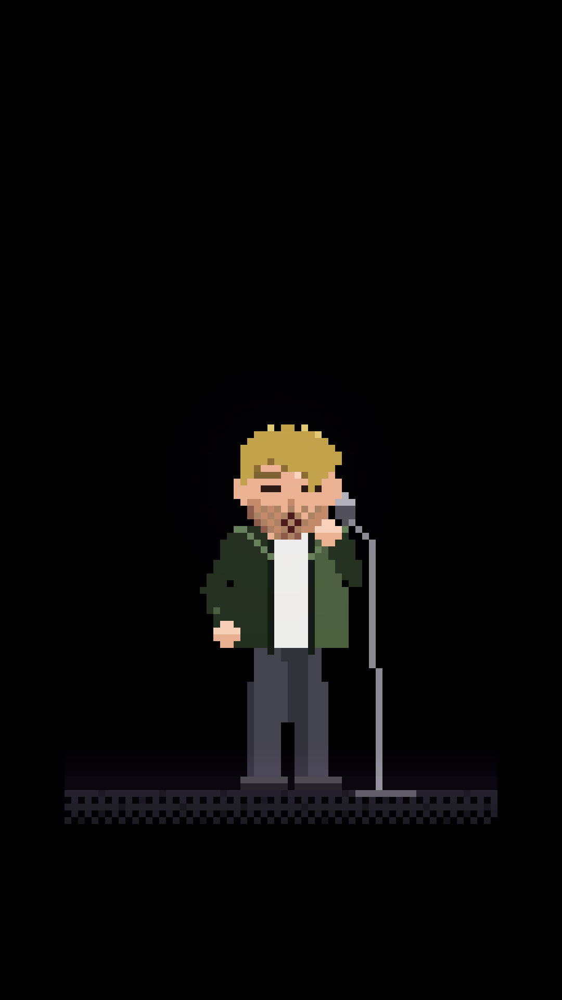
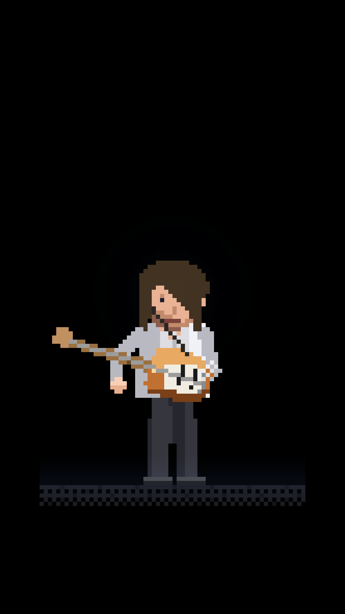
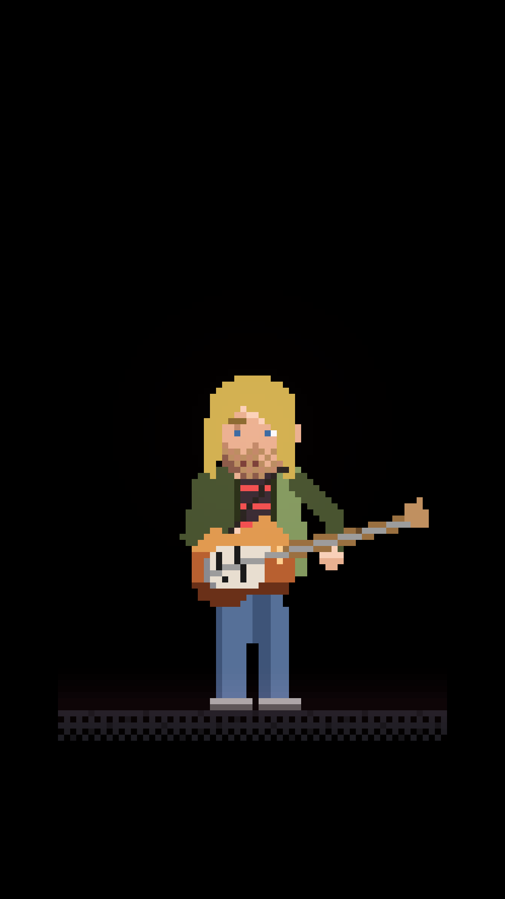
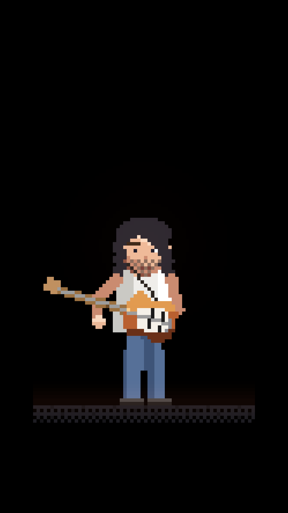
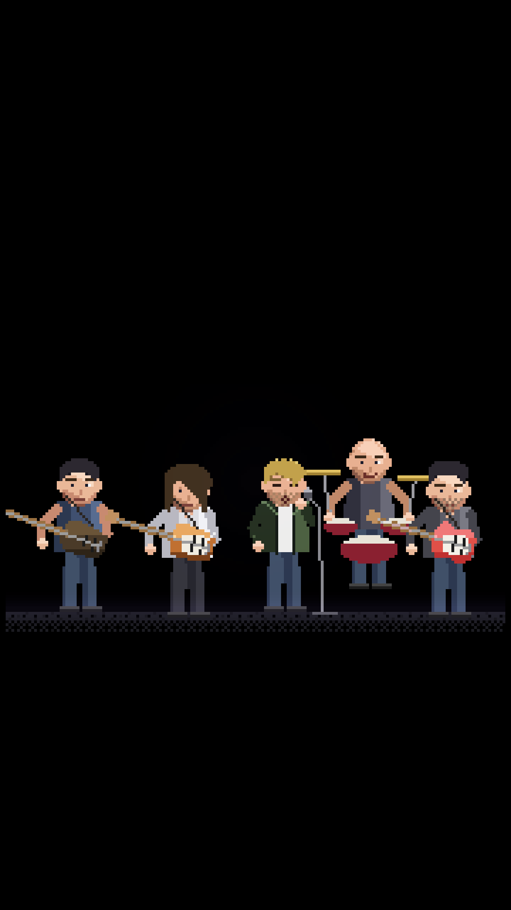
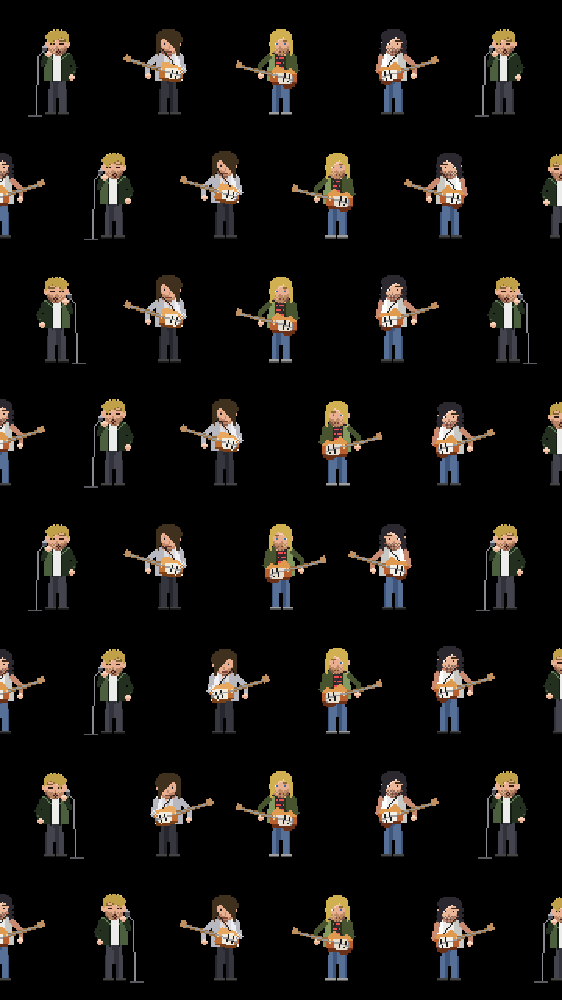

# pixelband — ミュージシャンのドット絵とスマホ壁紙

pixelsea のエンジン（`../pixelsea/src/core`）を使って描く、小さなピクセルの人物たち。実在のミュージシャンをモデルにした
「似顔キャラ」で、髪型・服・ギター・立ち姿などの特徴でそれとわかるように作っています。写真やロゴ、ジャケット画像は
使っていません。壁紙は黒背景の 1080×1920 です。

| | | |
|---|---|---|
|  |  |  |
|  |  |  |

## 使い方

```bash
cd pixelband
node tools/sheet.mjs --zoom 5 --out sheet.png                         # 全員のコンタクトシート
node tools/wallpaper.mjs --mode hero --who kurt --out docs/wallpapers/kurt.png
node tools/wallpaper.mjs --mode hero --who radiohead --zoom 6         # 五人並び
node tools/wallpaper.mjs --mode pattern --who thom,jonny,kurt,frusciante --cols 5 --zoom 3 --rowk 1.1
```

`--frame` でループ内の秒を選べます（手の位置や体の揺れが変わります）。`--seed` で敷き詰めの並びが変わります。

## 構成

```
src/kit.js        人物（頭・髪スプライト・顔・服 4 種・ポーズ 4 種・脚と靴）、ギター 5 種、マイクスタンド、ステージ
src/people/_lib.js 髪型の文字スプライトと髪色
src/people/*.js   thom / jonny / kurt / frusciante / radiohead（五人並び）
tools/            wallpaper / sheet（PNG 書き出しは pixelsea のものを流用）
```

## 人物を足す

`src/people/` のファイルをコピーして、`drawFigure` の `hair`（文字スプライト）、`face`、`shirt`、`pose`、`extra`（ギターやマイク）を
変えます。`src/index.js` に登録すればツールから使えます。
