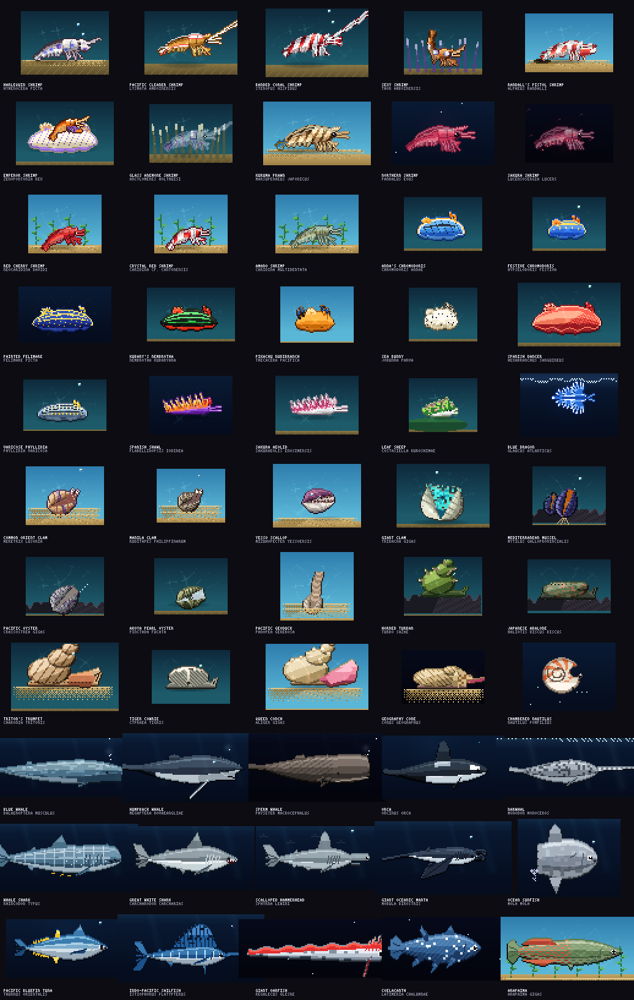

# pixelsea — 世界の海の生き物ドット絵集（エビ・ウミウシ・貝・鯨と大型魚）



[patch-gg/pixelfx](https://github.com/patch-gg/pixelfx) と同じ考え方で作った、**コードから描かれるドット絵**の図鑑です。
画像ファイルはひとつもありません。エビ 13 種、ウミウシ 12 種、貝 15 種、鯨・大型魚 15 種の計 55 種がそれぞれ `src/species/<category>/<name>.js` の小さなモジュールで、
時刻 `t` を渡すとその瞬間の姿を 64×48〜128×56 px のフレームに描きます。泳ぎ、脚の動き、触角の揺れ、エラの脈動、水管の伸び縮み、潮吹き、泡、水面のゆらめきまで全部コードです。

- **ブラウザで動かす**: `npm run gallery` → http://localhost:8080/ でライブ再生。色替え、鏡像、背景切り替え、スプライトシートの書き出しができます。
- **どのエンジンでも使う**: `node tools/render.mjs all --sheet` で透過 PNG + Aseprite 形式の JSON を書き出し。
- **GIF / MP4**: `node tools/render.mjs nudibranch --gif` / `--mp4`（MP4 は ffmpeg があれば）。
- 依存パッケージなし。Node 18+ だけで動きます。

## 図鑑

詳しい一覧（和名・学名・生息域・解説・GIF）は [docs/CATALOG.md](docs/CATALOG.md) に。

| エビ Shrimp (13) | ウミウシ Nudibranch (12) |
|---|---|
| フリソデエビ `shrimp/harlequin` | アンナウミウシ `nudibranch/anna` |
| アカシマシラヒゲエビ `shrimp/cleaner` | アオウミウシ `nudibranch/festiva` |
| オトヒメエビ `shrimp/banded-coral` | フェリマレ・ピクタ（地中海）`nudibranch/felimare` |
| イソギンチャクモエビ `shrimp/sexy` | クロスジリュウグウウミウシ `nudibranch/nembrotha` |
| ニシキテッポウエビ `shrimp/pistol` | ウデフリツノザヤウミウシ（ピカチュウ）`nudibranch/pikachu` |
| ウミウシカクレエビ（ホシゾラウミウシに乗る）`shrimp/emperor` | ゴマフビロードウミウシ（海のうさぎ）`nudibranch/sea-bunny` |
| イソギンチャクエビ `shrimp/glass` | ミカドウミウシ（スパニッシュダンサー）`nudibranch/spanish-dancer` |
| クルマエビ `shrimp/kuruma` | タテヒダイボウミウシ `nudibranch/phyllidia` |
| ホッコクアカエビ（甘エビ）`shrimp/amaebi` | スパニッシュショール（カリフォルニア）`nudibranch/spanish-shawl` |
| サクラエビ `shrimp/sakura` | サクラミノウミウシ `nudibranch/sakuraeolis` |
| レッドチェリーシュリンプ `shrimp/cherry` | テングモウミウシ（リーフシープ）`nudibranch/leaf-sheep` |
| レッドビーシュリンプ `shrimp/crystal-red` | アオミノウミウシ（ブルードラゴン）`nudibranch/blue-dragon` |
| ヤマトヌマエビ `shrimp/amano` | |

| 貝 Shellfish (15) | 鯨・大型魚 Whales & big fish (15) |
|---|---|
| ハマグリ `shell/hamaguri` | シロナガスクジラ `giants/blue-whale` |
| アサリ `shell/asari` | ザトウクジラ `giants/humpback` |
| ホタテガイ（泳ぐ）`shell/hotate` | マッコウクジラ `giants/sperm-whale` |
| オオシャコガイ `shell/shako` | シャチ `giants/orca` |
| ムラサキイガイ（ムール貝）`shell/mussel` | イッカク `giants/narwhal` |
| マガキ `shell/oyster` | ジンベエザメ `giants/whale-shark` |
| アコヤガイ（真珠）`shell/akoya` | ホホジロザメ `giants/great-white` |
| アメリカナミガイ（ジオダック）`shell/geoduck` | アカシュモクザメ `giants/hammerhead` |
| サザエ `shell/sazae` | オニイトマキエイ（マンタ）`giants/manta` |
| クロアワビ `shell/awabi` | マンボウ `giants/mola` |
| ホラガイ `shell/horagai` | クロマグロ `giants/tuna` |
| ホシダカラ（タカラガイ）`shell/takaragai` | バショウカジキ `giants/sailfish` |
| ピンクガイ（クイーンコンク）`shell/conch` | リュウグウノツカイ `giants/oarfish` |
| アンボイナガイ（イモガイ）`shell/imogai` | シーラカンス `giants/coelacanth` |
| オウムガイ `shell/nautilus` | ピラルク `giants/arapaima` |

## 使い方

```bash
cd pixelsea
npm run gallery                               # ブラウザのギャラリー
node tools/render.mjs shrimp/harlequin        # コンタクトシート records/shrimp/harlequin/contact.png
node tools/render.mjs nudibranch --gif        # ウミウシ全種 + GIF（shell、giants も同様）
node tools/render.mjs all --sheet             # 全種のスプライトシート（透過 PNG + JSON）
node tools/render.mjs shrimp/kuruma --opts '{"palette":["#102","#215","#43a","#8cf","#fff"]}'   # 色替え
node tools/montage.mjs                        # docs/montage.png
node tools/catalog.mjs                        # docs/CATALOG.md
node tools/previews.mjs                       # docs/previews/*.gif
```

JavaScript から直接:

```js
import { createFrame, createCreature, composite } from "./src/core/index.js";
import * as anna from "./src/species/nudibranch/anna.js";

const frame = createFrame(64, 44);                       // ゲームのピクセル解像度
const it = createCreature(anna, { x: 30, y: 26, seed: 3, palette: ["#102", "#215", "#43a", "#8cf", "#fff"] });
// 毎フレーム:
it.update(dt);
it.draw(frame);
composite(frame, imageData.data);                       // RGBA に合成して putImageData
```

オプションは `x, y, flip, angle, seed, light` と、各種が `meta.options` に持つ色のランプ（`palette`、`spots`、`cerata` など）。
長さの違うランプを渡しても既定の長さに揃えられるので、どの種にも同じパレットを渡せます。`scene: false` で砂地・水草・影・光のゆらめきなどの
「舞台」を消し、生き物だけを描きます（スプライトシートはこの状態で書き出されます）。

## 仕組み

```
src/core/        フレーム { w, h, ox, oy, color, light }、ペインタ、生き物用のオフスクリーン Grid（1px 輪郭つき）、色、乱数、ノイズ
src/species/     _lib.js   泡・影・コースティクス・砂地・イソギンチャク・水草
                 shrimp/_body.js      エビの体 (甲殻・腹節・尾扇・脚・遊泳肢・触角・ハサミ 5 種類) を仕様から描く
                 nudibranch/_body.js  ドーリス型（外套膜・触角・エラ）とミノ型（ミノ・口触手）を仕様から描く
                 shell/_body.js       二枚貝（蝶番・二枚の殻・外套膜・水管）と巻貝（螺層・足・触角・殻口）、岩
                 giants/_body.js      魚と鯨の体（体型プロファイル・尾びれ 6 種・背びれ 5 種・胸びれ・小離鰭・目・口・エラ）、潮吹き、水面光
                 <category>/<name>.js 種ごとの meta（和名・英名・学名・生息域・解説・サイズ・ループ）と draw(p, t, o)
tools/           render / montage / catalog / previews / serve（PNG・GIF エンコーダ内蔵、npm 依存なし）
gallery/         ライブ再生するギャラリー（index.html から読み込み）
```

すべての乱数はシード付きで、同じ `t` には必ず同じ絵が出ます。`seed` を変えると群れの個体がばらばらに動きます。

## 新しい種を足す

1. 近い種のファイルをコピーして `src/species/<category>/<name>.js` に置く。
2. `meta` を書き換える（`size` はキャンバス、`origin` は原点、`length` は実物の大きさ）。
3. `skin(u, v, x, y)` で模様を返す（u は頭 0 → 尾 1、v は背 -1 → 腹 1、返り値は暗→明のランプ）。エビは `drawShrimp`、ウミウシは `drawDorid` / `drawAeolid`、貝は `drawBivalve` / `drawSnail`、魚と鯨は `drawFish` の仕様を調整する。
4. `src/species/index.js` に登録し、`node tools/render.mjs <id> --zoom 6` で見ながら直す。

## クレジット

設計とコアの多くは pixelfx（MIT, Patch）を下敷きにしています。詳細は [NOTICE.md](NOTICE.md)。生き物の解説は図鑑的な要約で、学術的な正確さは保証しません。
