# Catalog / 図鑑

133 species, every one a small piece of code in `src/species/<category>/<name>.js`.

| | 和名 | Name | Scientific name | Region | Size |
|---|---|---|---|---|---|
| **エビ Shrimp** | | | | | |
| 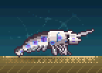 | フリソデエビ | Harlequin shrimp (`shrimp/harlequin`) | *Hymenocera picta* | Indo-Pacific reefs | 5 cm |
| 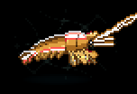 | アカシマシラヒゲエビ | Pacific cleaner shrimp (`shrimp/cleaner`) | *Lysmata amboinensis* | Indo-Pacific, Red Sea | 6 cm |
| 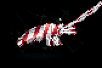 | オトヒメエビ | Banded coral shrimp (`shrimp/banded-coral`) | *Stenopus hispidus* | Tropical seas worldwide | 6 cm |
| 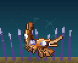 | イソギンチャクモエビ | Sexy shrimp (`shrimp/sexy`) | *Thor amboinensis* | Tropical seas worldwide | 1.5 cm |
|  | ニシキテッポウエビ | Randall's pistol shrimp (`shrimp/pistol`) | *Alpheus randalli* | Indo-Pacific sand flats | 3 cm |
| 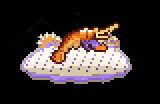 | ウミウシカクレエビ | Emperor shrimp (`shrimp/emperor`) | *Zenopontonia rex* | Indo-West Pacific | 2 cm |
| 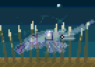 | イソギンチャクエビ | Glass anemone shrimp (`shrimp/glass`) | *Ancylomenes holthuisi* | Indo-Pacific reefs | 2.5 cm |
| 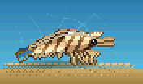 | クルマエビ | Kuruma prawn (`shrimp/kuruma`) | *Marsupenaeus japonicus* | Japan, Indo-West Pacific | 20 cm |
| 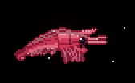 | ホッコクアカエビ（甘エビ） | Northern shrimp (`shrimp/amaebi`) | *Pandalus eous* | North Pacific, 200–600 m deep | 12 cm |
| 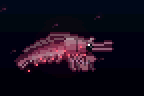 | サクラエビ | Sakura shrimp (`shrimp/sakura`) | *Lucensosergia lucens* | Suruga Bay, Japan; Taiwan | 4 cm |
| 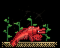 | レッドチェリーシュリンプ | Red cherry shrimp (`shrimp/cherry`) | *Neocaridina davidi* | Taiwan streams (freshwater), aquaria worldwide | 3 cm |
| 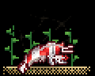 | レッドビーシュリンプ | Crystal red shrimp (`shrimp/crystal-red`) | *Caridina cf. cantonensis* | Bred in Japan (freshwater), from southern China stock | 2.5 cm |
| 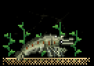 | ヤマトヌマエビ | Amano shrimp (`shrimp/amano`) | *Caridina multidentata* | Japan, Taiwan (freshwater rivers) | 5 cm |
| **ウミウシ Nudibranch** | | | | | |
| 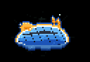 | アンナウミウシ | Anna's chromodoris (`nudibranch/anna`) | *Chromodoris annae* | Western Pacific (Philippines, Indonesia, Okinawa) | 4 cm |
| 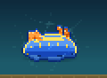 | アオウミウシ | Festive chromodoris (`nudibranch/festiva`) | *Hypselodoris festiva* | Japan, Korea (temperate rocky shores) | 3 cm |
| 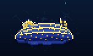 | フェリマレ・ピクタ（和名なし） | Painted felimare (`nudibranch/felimare`) | *Felimare picta* | Mediterranean, eastern Atlantic | 20 cm |
| 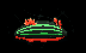 | クロスジリュウグウウミウシ | Kubary's nembrotha (`nudibranch/nembrotha`) | *Nembrotha kubaryana* | Indo-West Pacific reefs | 12 cm |
| 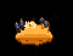 | ウデフリツノザヤウミウシ | Pikachu nudibranch (`nudibranch/pikachu`) | *Thecacera pacifica* | Indo-West Pacific, Japan | 3 cm |
| 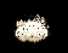 | ゴマフビロードウミウシ | Sea bunny (`nudibranch/sea-bunny`) | *Jorunna parva* | Japan to the Indo-Pacific | 2 cm |
| 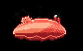 | ミカドウミウシ | Spanish dancer (`nudibranch/spanish-dancer`) | *Hexabranchus sanguineus* | Indo-Pacific, Red Sea | 40 cm |
|  | タテヒダイボウミウシ | Varicose phyllidia (`nudibranch/phyllidia`) | *Phyllidia varicosa* | Indo-West Pacific reefs | 8 cm |
| 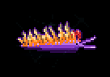 | スパニッシュショール | Spanish shawl (`nudibranch/spanish-shawl`) | *Flabellinopsis iodinea* | California to Baja California | 5 cm |
| 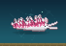 | サクラミノウミウシ | Sakura aeolid (`nudibranch/sakuraeolis`) | *Sakuraeolis enosimensis* | Japan (Pacific coast of Honshu) | 4 cm |
| 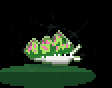 | テングモウミウシ | Leaf sheep (`nudibranch/leaf-sheep`) | *Costasiella kuroshimae* | Japan (Kuroshima), Indonesia, Philippines | 5 mm |
| 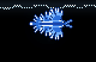 | アオミノウミウシ | Blue dragon (`nudibranch/blue-dragon`) | *Glaucus atlanticus* | Open ocean worldwide, warm seas | 3 cm |
| **貝 Shellfish** | | | | | |
| 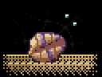 | ハマグリ | Common orient clam (`shell/hamaguri`) | *Meretrix lusoria* | Japan, Korea, China (tidal sand flats) | 8 cm |
| 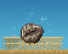 | アサリ | Manila clam (`shell/asari`) | *Ruditapes philippinarum* | Japan and East Asia; introduced worldwide | 4 cm |
| 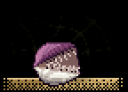 | ホタテガイ | Yesso scallop (`shell/hotate`) | *Mizuhopecten yessoensis* | Hokkaido, Tohoku, Sakhalin, Korea | 15 cm |
| 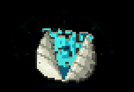 | オオシャコガイ | Giant clam (`shell/shako`) | *Tridacna gigas* | Coral reefs of the Indo-Pacific | 120 cm |
| 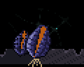 | ムラサキイガイ | Mediterranean mussel (`shell/mussel`) | *Mytilus galloprovincialis* | Mediterranean and Atlantic Europe; introduced to Japan and worldwide | 8 cm |
| 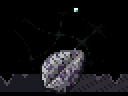 | マガキ | Pacific oyster (`shell/oyster`) | *Crassostrea gigas* | Japan; farmed on every continent but Antarctica | 15 cm |
| 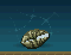 | アコヤガイ | Akoya pearl oyster (`shell/akoya`) | *Pinctada fucata* | Japan (Mie, Ehime, Nagasaki), Indo-Pacific | 7 cm |
| 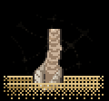 | アメリカナミガイ | Pacific geoduck (`shell/geoduck`) | *Panopea generosa* | Pacific coast of North America (Alaska to Baja California) | 20 cm shell, siphon to 1 m |
| 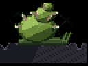 | サザエ | Horned turban (`shell/sazae`) | *Turbo sazae* | Japan, Korea (rocky shores) | 10 cm |
| 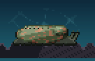 | クロアワビ | Japanese abalone (`shell/awabi`) | *Haliotis discus discus* | Japan (Pacific coast), Korea | 20 cm |
| 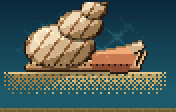 | ホラガイ | Triton's trumpet (`shell/horagai`) | *Charonia tritonis* | Indo-Pacific coral reefs | 50 cm |
| 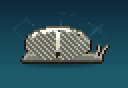 | ホシダカラ | Tiger cowrie (`shell/takaragai`) | *Cypraea tigris* | Indo-Pacific reefs, south to Okinawa | 10 cm |
| 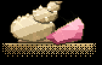 | ピンクガイ | Queen conch (`shell/conch`) | *Aliger gigas* | Caribbean Sea, Bahamas, Florida | 30 cm |
| 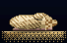 | アンボイナガイ | Geography cone (`shell/imogai`) | *Conus geographus* | Indo-Pacific reefs, north to Okinawa | 12 cm |
| 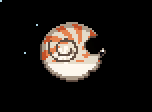 | オウムガイ | Chambered nautilus (`shell/nautilus`) | *Nautilus pompilius* | Western Pacific, 100–500 m (Philippines, Palau, Fiji) | 20 cm |
| **鯨・大型魚 Whales & big fish** | | | | | |
| 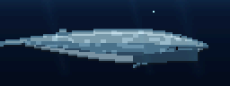 | シロナガスクジラ | Blue whale (`giants/blue-whale`) | *Balaenoptera musculus* | All oceans; feeds in polar seas, breeds in the tropics | 30 m |
| 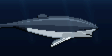 | ザトウクジラ | Humpback whale (`giants/humpback`) | *Megaptera novaeangliae* | All oceans; Okinawa and Ogasawara in winter, Alaska in summer | 15 m |
| 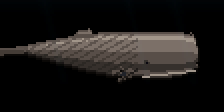 | マッコウクジラ | Sperm whale (`giants/sperm-whale`) | *Physeter macrocephalus* | All deep oceans; Ogasawara, Kochi and Hokkaido waters | 18 m |
| 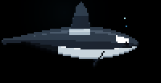 | シャチ | Orca (`giants/orca`) | *Orcinus orca* | Every ocean, from the poles to the equator | 8 m |
| 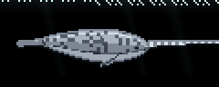 | イッカク | Narwhal (`giants/narwhal`) | *Monodon monoceros* | Arctic Ocean: Canada, Greenland, Svalbard | 5 m (tusk to 3 m) |
| 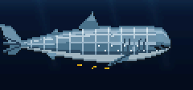 | ジンベエザメ | Whale shark (`giants/whale-shark`) | *Rhincodon typus* | Tropical and warm seas worldwide; Okinawa, Ningaloo, Cebu | 12 m |
| 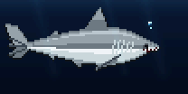 | ホホジロザメ | Great white shark (`giants/great-white`) | *Carcharodon carcharias* | Temperate seas worldwide; South Africa, Australia, California, Japan | 6 m |
| 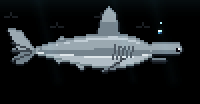 | アカシュモクザメ | Scalloped hammerhead (`giants/hammerhead`) | *Sphyrna lewini* | Warm seas worldwide; famous schools at Yonaguni, Galápagos, Cocos | 4 m |
| 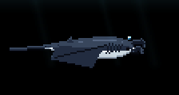 | オニイトマキエイ | Giant oceanic manta (`giants/manta`) | *Mobula birostris* | Tropical and warm seas worldwide; Ishigaki, Ogasawara | 7 m across |
| 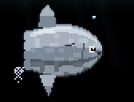 | マンボウ | Ocean sunfish (`giants/mola`) | *Mola mola* | Temperate and tropical seas worldwide | 3 m, up to 2 tonnes |
| 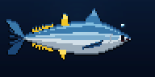 | クロマグロ | Pacific bluefin tuna (`giants/tuna`) | *Thunnus orientalis* | North Pacific, Japan to California | 3 m |
| 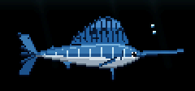 | バショウカジキ | Indo-Pacific sailfish (`giants/sailfish`) | *Istiophorus platypterus* | Indo-Pacific; Japan in summer and autumn | 3.5 m |
|  | リュウグウノツカイ | Giant oarfish (`giants/oarfish`) | *Regalecus glesne* | Deep open ocean worldwide, 200–1000 m; washes up on the Sea of Japan coast | 8 m, to 11 m |
|  | シーラカンス | Coelacanth (`giants/coelacanth`) | *Latimeria chalumnae* | Comoros, Mozambique Channel, South Africa, 150–700 m | 2 m |
|  | ピラルク | Arapaima (`giants/arapaima`) | *Arapaima gigas* | Amazon and Essequibo basins (freshwater) | 3 m |
| **海藻 Seaweed** | | | | | |
|  | マコンブ | Kombu kelp (`seaweed/kombu`) | *Saccharina japonica* | Hokkaido, northern Japan, Russian Far East | 3–6 m |
|  | ワカメ | Wakame (`seaweed/wakame`) | *Undaria pinnatifida* | Japan, Korea, China; invasive worldwide | 1–2 m |
|  | ヒジキ | Hijiki (`seaweed/hijiki`) | *Sargassum fusiforme* | Japan, Korea, China (rocky intertidal) | 50 cm – 1 m |
|  | アカモク（ホンダワラ類） | Sargassum weed (`seaweed/hondawara`) | *Sargassum horneri* | Japan, Korea, China; drifts across the North Pacific | 3–7 m |
|  | アオサ | Sea lettuce (`seaweed/aosa`) | *Ulva (Monostroma) spp.* | Rocky shores worldwide | 10–30 cm |
|  | マクサ（テングサ） | Agar weed (`seaweed/tengusa`) | *Gelidium elegans* | Japan, Korea (rocky subtidal) | 10–30 cm |
|  | ジャイアントケルプ | Giant kelp (`seaweed/giant-kelp`) | *Macrocystis pyrifera* | California, Chile, South Africa, Australia, New Zealand | 30–45 m |
|  | スサビノリ | Nori laver (`seaweed/nori`) | *Neopyropia yezoensis* | Japan, Korea, China (cultivated on nets) | 15–30 cm |
|  | クビレヅタ（海ぶどう） | Sea grapes (`seaweed/umibudo`) | *Caulerpa lentillifera* | Okinawa, Philippines, Southeast Asia | 5–10 cm |
|  | カジメ | Kajime kelp (`seaweed/kajime`) | *Ecklonia cava* | Pacific coast of Japan, Korea | 1–2 m |
|  | ミル | Dead man's fingers (`seaweed/miru`) | *Codium fragile* | Japan and the North Pacific; spread worldwide | 20–40 cm |
| **サンゴ Coral** | | | | | |
|  | テーブル状ミドリイシ | Table coral (`coral/table`) | *Acropora hyacinthus* | Indo-Pacific reefs; Okinawa, Great Barrier Reef | 1–3 m across |
|  | スギノキミドリイシ | Staghorn coral (`coral/staghorn`) | *Acropora muricata* | Indo-Pacific reefs; Okinawa, Great Barrier Reef | branches to 2 m |
|  | ハマサンゴ | Boulder coral (`coral/porites`) | *Porites lobata* | Indo-Pacific reefs | to 6 m across, 1000 years old |
|  | キクメイシ | Brain coral (`coral/favia`) | *Dipsastraea speciosa* | Indo-Pacific reefs; Okinawa, Kii Peninsula | 30 cm – 1 m |
|  | ナガレハナサンゴ | Hammer coral (`coral/hammer`) | *Fimbriaphyllia ancora* | Indo-Pacific reefs, sheltered lagoons | colonies to 1 m |
|  | ウミトサカ（トゲトサカ） | Carnation tree coral (`coral/dendronephthya`) | *Dendronephthya sp.* | Indo-Pacific; Izu, Okinawa, Red Sea walls and overhangs | 30 cm – 1 m |
|  | ウミウチワ | Sea fan (`coral/sea-fan`) | *Annella mollis* | Indo-Pacific; Okinawa, Andaman Sea, Red Sea | 1–2 m |
|  | イソバナ | Red gorgonian (`coral/isobana`) | *Melithaea japonica* | Japan (Sagami Bay, Izu, Kii), Korea | 30–60 cm |
|  | クダサンゴ | Organ pipe coral (`coral/organ-pipe`) | *Tubipora musica* | Indo-Pacific reefs; Okinawa, Red Sea | colonies 10–30 cm |
|  | アカサンゴ | Japanese red coral (`coral/red-coral`) | *Corallium japonicum* | Japan (Kochi, Okinawa, Ogasawara), 100–300 m deep | 20–40 cm |
|  | ウミキノコ | Mushroom leather coral (`coral/leather`) | *Sarcophyton sp.* | Indo-Pacific reefs; Okinawa lagoons | 20 cm – 1 m |
|  | ハナガササンゴ | Flowerpot coral (`coral/goniopora`) | *Goniopora sp.* | Indo-Pacific reefs, turbid lagoons | colonies 20–50 cm |
|  | クサビライシ | Mushroom coral (`coral/fungia`) | *Fungia fungites* | Indo-Pacific reefs, sandy lagoon floors | 10–20 cm |
| **イカ・タコ Squid & octopus** | | | | | |
|  | アオリイカ | Bigfin reef squid (`cephalopod/aori`) | *Sepioteuthis lessoniana* | Indo-Pacific; Japan south of Hokkaido | 40 cm |
|  | スルメイカ | Japanese flying squid (`cephalopod/surume`) | *Todarodes pacificus* | Sea of Japan and the North Pacific around Japan | 30 cm |
|  | ホタルイカ | Firefly squid (`cephalopod/hotaru`) | *Watasenia scintillans* | Western Pacific; Toyama Bay, Japan | 7 cm |
|  | ダイオウイカ | Giant squid (`cephalopod/daiou`) | *Architeuthis dux* | Deep oceans worldwide, 300–1000 m; Ogasawara, Sea of Japan | 13 m with tentacles |
|  | アメリカオオアカイカ | Humboldt squid (`cephalopod/humboldt`) | *Dosidicus gigas* | Eastern Pacific, Chile to California; Japanese fleets fish it off Peru | 1.5 m |
|  | コウイカ（スミイカ） | Golden cuttlefish (`cephalopod/kouika`) | *Sepia esculenta* | Japan, Korea, China (coastal, sandy bottoms) | 18 cm |
|  | ハナイカ | Flamboyant cuttlefish (`cephalopod/hanaika`) | *Metasepia tullbergi* | Japan (Kyushu, Okinawa) to the South China Sea | 8 cm |
|  | ミミイカ | Bobtail squid (`cephalopod/mimiika`) | *Euprymna berryi* | Japan, Korea, China (shallow sand) | 4 cm |
|  | マダコ | Common octopus (`cephalopod/madako`) | *Octopus sinensis* | Japan, Korea, China; the Atlantic has its twin O. vulgaris | 60 cm, arms to 1 m |
|  | ミズダコ | Giant Pacific octopus (`cephalopod/mizudako`) | *Enteroctopus dofleini* | North Pacific; Hokkaido, Alaska, British Columbia | 3–5 m across, 50 kg |
|  | ヒョウモンダコ | Blue-lined octopus (`cephalopod/hyoumon`) | *Hapalochlaena fasciata* | Japan (south of Chiba), Australia (shallow reefs, tide pools) | 10 cm |
|  | ミミックオクトパス | Mimic octopus (`cephalopod/mimic`) | *Thaumoctopus mimicus* | Indonesia, Malaysia, Philippines (muddy sand flats) | 60 cm |
|  | メンダコ | Flapjack octopus (`cephalopod/mendako`) | *Opisthoteuthis depressa* | Japan, 200–1000 m deep (Sagami Bay, Suruga Bay) | 20 cm |
|  | カイダコ（アオイガイ） | Paper nautilus (`cephalopod/kaidako`) | *Argonauta argo* | Warm open seas worldwide; blown ashore on the Sea of Japan coast | shell 20 cm (female); male 2 cm |
|  | コウモリダコ | Vampire squid (`cephalopod/koumoridako`) | *Vampyroteuthis infernalis* | Deep oceans worldwide, 600–900 m, in the oxygen-minimum zone | 30 cm |
| **クラゲ Jellyfish** | | | | | |
|  | ミズクラゲ | Moon jelly (`jelly/mizukurage`) | *Aurelia coerulea* | Coastal seas worldwide; every Japanese harbour in summer | 20–30 cm |
|  | アカクラゲ | Japanese sea nettle (`jelly/akakurage`) | *Chrysaora pacifica* | Japan, Korea, China (coastal) | bell 20 cm, tentacles 2 m |
|  | エチゼンクラゲ | Nomura's jellyfish (`jelly/echizen`) | *Nemopilema nomurai* | Yellow Sea, East China Sea, Sea of Japan | bell 2 m, 200 kg |
|  | キタユウレイクラゲ（ライオンズメーン） | Lion's mane jellyfish (`jelly/lionsmane`) | *Cyanea capillata* | Arctic and cold northern seas; Hokkaido in winter | bell 2 m, tentacles 30 m |
|  | カツオノエボシ | Portuguese man o' war (`jelly/katsuonoeboshi`) | *Physalia physalis* | Warm oceans worldwide; blown onto Japanese beaches in summer | float 12 cm, tentacles 10 m |
|  | アンドンクラゲ | Japanese box jelly (`jelly/andon`) | *Carybdea brevipedalia* | Japan (Honshu south), Korea; shallow bays after mid-August | bell 3 cm, tentacles 20 cm |
|  | ベニクラゲ | Immortal jellyfish (`jelly/benikurage`) | *Turritopsis dohrnii* | Mediterranean and Japan (Shirahama, Kagoshima); spreading worldwide | 4 mm |
|  | タコクラゲ | Spotted jelly (`jelly/takokurage`) | *Mastigias papua* | Western Pacific; Palau lakes, Okinawa, Japan in autumn | bell 10 cm |
|  | サカサクラゲ | Upside-down jellyfish (`jelly/sakasakurage`) | *Cassiopea ornata* | Okinawa, Indo-Pacific mangroves and lagoons | bell 15 cm |
|  | オワンクラゲ | Crystal jelly (`jelly/owankurage`) | *Aequorea coerulescens* | North Pacific; Japan, California | bell 10–20 cm |
|  | ハナガサクラゲ | Flower hat jelly (`jelly/hanagasa`) | *Olindias formosus* | Japan (Honshu), Korea; shallow water in spring | bell 15 cm |
|  | ウリクラゲ（クシクラゲ） | Comb jelly (`jelly/urikurage`) | *Beroe cucumis* | Cold and temperate seas worldwide; Japan in winter | 10–15 cm |
| **カニ・ヤドカリ Crabs & hermits** | | | | | |
|  | タカアシガニ | Japanese spider crab (`crab/takaashi`) | *Macrocheira kaempferi* | Pacific coast of Japan, 150–600 m (Suruga Bay) | legs span 3.8 m |
|  | ズワイガニ | Snow crab (`crab/zuwai`) | *Chionoecetes opilio* | Sea of Japan, Okhotsk, Bering Sea, 200–600 m | shell 15 cm, legs 70 cm |
|  | タラバガニ | Red king crab (`crab/taraba`) | *Paralithodes camtschaticus* | Okhotsk, Bering Sea, Alaska; Hokkaido | legs span 1.8 m |
|  | ケガニ | Horsehair crab (`crab/kegani`) | *Erimacrus isenbeckii* | Hokkaido, Okhotsk, Bering Sea | shell 12 cm |
|  | ガザミ（ワタリガニ） | Japanese blue crab (`crab/gazami`) | *Portunus trituberculatus* | Japan, Korea, China (sandy bays) | shell 20 cm wide |
|  | シオマネキ | Fiddler crab (`crab/shiomaneki`) | *Tubuca arcuata* | Mud flats of western Japan (Ariake Sea), Korea, China | shell 3.5 cm |
|  | イソガニ | Asian shore crab (`crab/isogani`) | *Hemigrapsus sanguineus* | Japan, Korea, China tide pools; invasive on US and European coasts | shell 3.5 cm |
|  | キンチャクガニ | Pom-pom crab (`crab/kinchaku`) | *Lybia tessellata* | Indo-Pacific reefs; Okinawa | shell 1.5 cm |
|  | モクズガニ | Japanese mitten crab (`crab/mokuzu`) | *Eriocheir japonica* | Rivers of Japan, Taiwan, Korea; spawns in the sea | shell 8 cm |
|  | ヤシガニ | Coconut crab (`crab/yashigani`) | *Birgus latro* | Islands of the Indo-Pacific; Okinawa and Ogasawara | legs span 1 m, 4 kg |
|  | ホンヤドカリ | Common hermit crab (`crab/honyadokari`) | *Pagurus filholi* | Japan, Korea (tide pools) | 1–2 cm |
|  | オカヤドカリ | Land hermit crab (`crab/okayadokari`) | *Coenobita purpureus* | Okinawa and the Nansei Islands (beaches and coastal forest) | shell 3 cm |
|  | ユビワサンゴヤドカリ | Electric blue hermit crab (`crab/yubiwa`) | *Calcinus elegans* | Indo-Pacific reefs; Okinawa | shell 2 cm |
| **深海魚 Deep-sea fish** | | | | | |
|  | チョウチンアンコウ | Footballfish (`deepsea/chouchin`) | *Himantolophus sagamius* | Deep Pacific, 200–800 m; named for Sagami Bay | female 40 cm, male 4 cm |
|  | デメニギス | Barreleye (`deepsea/demenigisu`) | *Macropinna microstoma* | North Pacific, 600–800 m; Suruga Bay | 15 cm |
|  | ミツクリザメ | Goblin shark (`deepsea/mitsukuri`) | *Mitsukurina owstoni* | Deep slopes worldwide, 200–1300 m; Sagami Bay and Suruga Bay | 3–4 m |
|  | ラブカ | Frilled shark (`deepsea/rabuka`) | *Chlamydoselachus anguineus* | Deep slopes worldwide, 500–1000 m; Suruga Bay | 2 m |
|  | ホウライエソ | Pacific viperfish (`deepsea/houraieso`) | *Chauliodus macouni* | North Pacific, 200–1500 m; Japan | 30 cm |
|  | オニキンメ | Fangtooth (`deepsea/onikinme`) | *Anoplogaster cornuta* | Deep oceans worldwide, 500–2000 m | 16 cm |
|  | フクロウナギ | Gulper eel (`deepsea/fukurounagi`) | *Eurypharynx pelecanoides* | Deep oceans worldwide, 500–3000 m | 75 cm |
|  | ハダカイワシ | Lanternfish (`deepsea/hadakaiwashi`) | *Diaphus watasei* | Mesopelagic worldwide, 300–1000 m by day, near the surface by night | 10 cm |
|  | ヨコエソ | Bristlemouth (`deepsea/yokoeso`) | *Cyclothone alba* | Mesopelagic worldwide, 300–1500 m | 3–5 cm |
|  | ソコダラ（イバラヒゲ） | Pacific grenadier (`deepsea/sokodara`) | *Coryphaenoides acrolepis* | North Pacific slopes, 300–3700 m; Japan | 90 cm |
|  | シンカイクサウオ | Mariana snailfish (`deepsea/kusauo`) | *Pseudoliparis swirei* | Mariana Trench, 6000–8000 m; relatives off Japan to 8300 m | 25 cm |
|  | ニュウドウカジカ（ブロブフィッシュ） | Blobfish (`deepsea/blobfish`) | *Psychrolutes marcidus* | Australia and New Zealand, 600–1200 m | 30 cm |
|  | ミズウオ | Longnose lancetfish (`deepsea/mizuuo`) | *Alepisaurus ferox* | Oceans worldwide, 200–1800 m; washed up on Suruga Bay beaches in winter | 2 m |
|  | オオクチホシエソ | Stoplight loosejaw (`deepsea/hoshieso`) | *Malacosteus niger* | Deep oceans worldwide, 500–1000 m | 25 cm |

## エビ Shrimp

Reef cleaners, snappers, dancers and the ones on your plate, from every ocean.

### フリソデエビ — Harlequin shrimp

*Hymenocera picta* · Indo-Pacific reefs · 5 cm · `shrimp/harlequin` · 72×52 px, 3 s loop at 30 fps

青紫の斑点をまとった白い体に、振袖のような平たいハサミ。ヒトデだけを食べるインド太平洋のサンゴ礁の住人。

A cream-white shrimp dappled in blue-rimmed violet spots, waving two flat petal-like claws as it picks over the reef for the starfish it eats.

tags: shrimp, reef, indo-pacific, spots, loop

### アカシマシラヒゲエビ — Pacific cleaner shrimp

*Lysmata amboinensis* · Indo-Pacific, Red Sea · 6 cm · `shrimp/cleaner` · 76×52 px, 3.2 s loop at 30 fps

黄金色の体に、白い筋を通した真紅の背中。長い白いヒゲを振って魚を呼び、口や体の寄生虫を掃除する「クリーナーシュリンプ」。

The reef's barber: a golden shrimp with a scarlet back split by a white stripe, waving long white antennae to call fish in for a cleaning.

tags: shrimp, reef, cleaner, indo-pacific, loop

### オトヒメエビ — Banded coral shrimp

*Stenopus hispidus* · Tropical seas worldwide · 6 cm · `shrimp/banded-coral` · 84×56 px, 3.4 s loop at 30 fps

紅白の縞に、長く伸ばした棘だらけの腕。体の何倍もある白いヒゲをたなびかせ、岩陰でつがいで暮らす世界中の熱帯の海の「ボクサーシュリンプ」。

The boxer shrimp: white and scarlet bands, spiny arms held wide like a prizefighter's, and white antennae three times its length, usually seen as a pair under a ledge.

tags: shrimp, reef, cleaner, bands, loop

### イソギンチャクモエビ — Sexy shrimp

*Thor amboinensis* · Tropical seas worldwide · 1.5 cm · `shrimp/sexy` · 64×52 px, 2.4 s loop at 30 fps

イソギンチャクの触手の間に住む親指の爪ほどのエビ。栗色に白い鞍模様。尾を高く上げて左右に揺らして歩く「ダンス」が名前の由来。

A thumbnail-sized shrimp living among anemone tentacles, chestnut with white saddles, famous for holding its tail high and swaying it side to side as it walks: the dance that named it.

tags: shrimp, anemone, tiny, dance, loop

### ニシキテッポウエビ — Randall's pistol shrimp

*Alpheus randalli* · Indo-Pacific sand flats · 3 cm · `shrimp/pistol` · 72×48 px, 2.8 s loop at 30 fps

紅白の縞に、片方だけ大砲のように巨大化したハサミ。閉じる勢いで水中に衝撃波を起こす「テッポウ」。目が弱く、巣穴の見張り役としてハゼと共生する。

A snapping shrimp in red and white bands with one claw grown into a cannon: it snaps shut so fast the water cavitates with a crack. Nearly blind, it digs a burrow and keeps a goby as its lookout.

tags: shrimp, sand, snapping, burrow, loop

### ウミウシカクレエビ — Emperor shrimp

*Zenopontonia rex* · Indo-West Pacific · 2 cm · `shrimp/emperor` · 80×52 px, 3.8 s loop at 30 fps

背中に白い筋、紫のハサミをもつ小さなオレンジのエビ。大きなウミウシ（ここではホシゾラウミウシ）の背に乗り、その粘液についた餌をつまみながら旅をする。

A tiny orange shrimp with a white stripe down its back and violet claws, riding a big nudibranch (here a Tryon's hypselodoris) like a mahout, picking food from the slug's slime as it goes.

tags: shrimp, nudibranch, symbiosis, reef, loop

### イソギンチャクエビ — Glass anemone shrimp

*Ancylomenes holthuisi* · Indo-Pacific reefs · 2.5 cm · `shrimp/glass` · 68×48 px, 3 s loop at 30 fps

体がほぼ透明で、向こうのイソギンチャクが透けて見える。白と紫の鞍模様と、尾や脚のライラック色の帯だけが居場所を教えてくれる。

A shrimp made of glass: you see the anemone through its body. Only its saddles of white and violet, and the lilac bands on its tail and legs, give it away as it hovers among the tentacles.

tags: shrimp, anemone, transparent, reef, loop

### クルマエビ — Kuruma prawn

*Marsupenaeus japonicus* · Japan, Indo-West Pacific · 20 cm · `shrimp/kuruma` · 88×52 px, 3.6 s loop at 30 fps

淡いクリーム色の体に、車輪のように巡る茶色の縞。尾扇は青と黄色に染まる。昼は砂に潜り、夜に餌を探す日本を代表する高級エビ。

Japan's prized prawn: a sandy cream body wrapped in brown bands like the spokes of a wheel (kuruma), a tail fan tipped blue and yellow. It buries itself in sand by day and forages at night.

tags: shrimp, sand, japan, prawn, food, loop

### ホッコクアカエビ（甘エビ） — Northern shrimp

*Pandalus eous* · North Pacific, 200–600 m deep · 12 cm · `shrimp/amaebi` · 84×52 px, 3.8 s loop at 30 fps

寿司屋の「甘エビ」。透き通った紅色の体に、長いノコギリ状の額角、暗い深海で光を集める大きな黒い目。雄として生まれ、数年で雌に性転換する。

The sweet shrimp of sushi counters: a glassy rose-red body, a long saw-toothed rostrum and big black eyes for the dim cold water. Born male, it turns female after a few years.

tags: shrimp, deep, japan, cold, food, loop

### サクラエビ — Sakura shrimp

*Lucensosergia lucens* · Suruga Bay, Japan; Taiwan · 4 cm · `shrimp/sakura` · 72×48 px, 3 s loop at 30 fps

ガラスのように透き通った桜色の体に、約160個の赤い発光器を散りばめる。夜に深海から群れで浮上し、駿河湾と台湾沖でしか漁が行われない。

A glass-clear shrimp flushed cherry pink, studded with some 160 red light organs that glow in the dark. It rises from 200 m at night in swarms, and is fished in only two bays on Earth.

tags: shrimp, deep, japan, glow, swarm, loop

### レッドチェリーシュリンプ — Red cherry shrimp

*Neocaridina davidi* · Taiwan streams (freshwater), aquaria worldwide · 3 cm · `shrimp/cherry` · 60×48 px, 2.8 s loop at 30 fps

台湾の川のエビを品種改良した真紅の小さなエビ。水草やガラスの藻を一日中つまむ、アクアリウムの定番。

A wild brown stream shrimp from Taiwan bred into solid cherry red: the beginner's aquarium shrimp, forever grazing algae on leaves and glass with a pair of fan-like front feet.

tags: shrimp, freshwater, aquarium, red, loop

### レッドビーシュリンプ — Crystal red shrimp

*Caridina cf. cantonensis* · Bred in Japan (freshwater), from southern China stock · 2.5 cm · `shrimp/crystal-red` · 60×48 px, 2.8 s loop at 30 fps

1990年代に日本で黒白のビーシュリンプの突然変異から作出された、白と赤のバンド模様。白の面積でグレード分けされる、今も世界で愛される観賞エビ。

Bred in Japan in the 1990s from a black-and-white bee shrimp mutation: porcelain white and candy red in bands, graded by how much white it carries. Still one of the most prized aquarium shrimps.

tags: shrimp, freshwater, aquarium, japan, bands, loop

### ヤマトヌマエビ — Amano shrimp

*Caridina multidentata* · Japan, Taiwan (freshwater rivers) · 5 cm · `shrimp/amano` · 68×48 px, 3 s loop at 30 fps

天野尚が世界に広めた苔取りエビ。透けたオリーブ色の体に、側面には錆色の点列、背中には淡い一本筋。幼生は海水が必要で、水槽内の繁殖は難しい。

The algae-eater Takashi Amano made famous: glassy olive-grey with a row of rust dots down each side and a pale stripe along the back. Its larvae need the sea, so it is rarely bred in tanks.

tags: shrimp, freshwater, aquarium, japan, loop

## ウミウシ Nudibranch

Sea slugs in every color they can find, from tide pools to the open sea.

### アンナウミウシ — Anna's chromodoris

*Chromodoris annae* · Western Pacific (Philippines, Indonesia, Okinawa) · 4 cm · `nudibranch/anna` · 64×44 px, 3.6 s loop at 30 fps

コーラルトライアングルを代表するウミウシ。黒い点と線を散らした空色の外套膜を、白とオレンジの縁取りが囲む。触角とエラも同じオレンジ。

The poster nudibranch of the Coral Triangle: a sky-blue mantle pricked with black, ruled with black lines and hemmed in white and orange, with orange rhinophores and gills to match.

tags: nudibranch, dorid, blue, reef, loop

### アオウミウシ — Festive chromodoris

*Hypselodoris festiva* · Japan, Korea (temperate rocky shores) · 3 cm · `nudibranch/festiva` · 60×44 px, 3.4 s loop at 30 fps

日本の磯でいちばん出会えるウミウシ。青い体の背中に黄色い線と点、縁は黄色、触角とエラはオレンジ。ウミウシの代名詞的存在。

Japan's best-loved sea slug, found in any tide pool from Honshu south: a blue body with a yellow line and dots along the back, a yellow hem, and orange rhinophores and gills.

tags: nudibranch, dorid, blue, japan, tidepool, loop

### フェリマレ・ピクタ（和名なし） — Painted felimare

*Felimare picta* · Mediterranean, eastern Atlantic · 20 cm · `nudibranch/felimare` · 76×46 px, 4 s loop at 30 fps

地中海を代表する大型のウミウシ。深い紺に黄色の線と斑点、黄色い縁取り、青と金のエラと触角。手のひらほどに育つ。

The Mediterranean's grand chromodorid: midnight blue laced with yellow lines and spots, a yellow hem, and gills and rhinophores in blue and gold. It can reach the length of a hand.

tags: nudibranch, dorid, blue, yellow, mediterranean, loop

### クロスジリュウグウウミウシ — Kubary's nembrotha

*Nembrotha kubaryana* · Indo-West Pacific reefs · 12 cm · `nudibranch/nembrotha` · 72×44 px, 3.8 s loop at 30 fps

ビロードのような黒い体に電撃のような緑の縦縞、触角・エラ・足の縁は赤橙。ホヤを食べて、その毒を自分の粘液に蓄える大型種。

A big velvet-black slug striped in electric green, with red-orange rhinophores, gills and foot edge. It grazes on sea squirts and recycles their toxins into its own slime.

tags: nudibranch, polycerid, black, green, reef, loop

### ウデフリツノザヤウミウシ — Pikachu nudibranch

*Thecacera pacifica* · Indo-West Pacific, Japan · 3 cm · `nudibranch/pikachu` · 60×46 px, 3.2 s loop at 30 fps

オレンジの体に、黒と青に染まった「耳」の触角と、エラの後ろにそろいの二本の角。ある電気ネズミに似ているとダイバーに大人気。這いながら腕を振るのが名前の由来。

Orange with black-and-blue tipped 'ears' and two matching horns behind the gills: the resemblance to a certain electric mouse has made it a diver favourite. It waves its arms (ude-furi) as it crawls.

tags: nudibranch, polycerid, orange, japan, cute, loop

### ゴマフビロードウミウシ — Sea bunny

*Jorunna parva* · Japan to the Indo-Pacific · 2 cm · `nudibranch/sea-bunny` · 56×44 px, 3.2 s loop at 30 fps

SNSで「海のうさぎ」として有名に。黒ゴマを散らしたビロードのような突起、黒い先端の触角が耳、エラが尻尾に見える。「毛」は水の匂いを感じる感覚器。

The internet's rabbit: a fuzz of tiny papillae sprinkled with black, two black-tipped rhinophores for ears and a gill tuft for a tail. The 'fur' is how it tastes the water.

tags: nudibranch, dorid, fuzzy, japan, cute, loop

### ミカドウミウシ — Spanish dancer

*Hexabranchus sanguineus* · Indo-Pacific, Red Sea · 40 cm · `nudibranch/spanish-dancer` · 84×52 px, 4 s loop at 30 fps

最大級のウミウシ。血のように赤い巨体で、普段は外套膜を巻いて這い、驚くと縁を広げてフラメンコのように身をくねらせて泳ぐ。卵塊は赤いバラの形。

The largest nudibranch, a blood-red giant that keeps its mantle rolled in when crawling and, disturbed, unfurls it and swims off in flamenco swirls. Its egg ribbon is a red rose.

tags: nudibranch, dorid, red, giant, swim, loop

### タテヒダイボウミウシ — Varicose phyllidia

*Phyllidia varicosa* · Indo-West Pacific reefs · 8 cm · `nudibranch/phyllidia` · 68×42 px, 4.2 s loop at 30 fps

灰青色の硬い体に黒い溝、黄色い先端のイボが並ぶ縦の畝。背中にエラの花はなく、外套膜の下に隠す。毒臭があり、水槽の魚を全滅させることも。

A tough, warty slug in grey-blue with black grooves between ridges of yellow-tipped bumps. It has no gill plume (its gills hide under the skirt) and smells of a toxin that can kill a tankful of fish.

tags: nudibranch, phyllidiid, warty, reef, toxic, loop

### スパニッシュショール — Spanish shawl

*Flabellinopsis iodinea* · California to Baja California · 5 cm · `nudibranch/spanish-shawl` · 68×48 px, 3.4 s loop at 30 fps

紫の体に燃えるようなオレンジの背側突起（ミノ）、深紅の触角。カリフォルニア沿岸の種で、危険を感じると岩を離れ、体をくねらせて泳いで逃げる。

A violet aeolid in a shawl of flame-orange cerata, with scarlet rhinophores. Nudged by a predator it lets go and swims off in violent twists, which is more than most slugs can manage.

tags: nudibranch, aeolid, purple, orange, pacific, loop

### サクラミノウミウシ — Sakura aeolid

*Sakuraeolis enosimensis* · Japan (Pacific coast of Honshu) · 4 cm · `nudibranch/sakuraeolis` · 68×48 px, 3.4 s loop at 30 fps

江ノ島と桜に名をもらったミノウミウシ。透き通った白い体に、先端が白い桜色のミノ。ミノの中には、食べたヒドロ虫から奪った刺胞を蓄えている。

Named for Enoshima and for the cherry blossom: a glassy white body under a cloud of pink cerata with white tips, each one holding the stinging cells it stole from the hydroids it eats.

tags: nudibranch, aeolid, pink, japan, loop

### テングモウミウシ — Leaf sheep

*Costasiella kuroshimae* · Japan (Kuroshima), Indonesia, Philippines · 5 mm · `nudibranch/leaf-sheep` · 56×44 px, 3 s loop at 30 fps

米粒ほどの小さなウミウシ。白い顔に黒い点の目、ピンクに染まる葉っぱのような緑のミノで「羊」そっくり。食べた藻の葉緑体を体に取り込み、しばらく光合成で生きる。

A sea slug the size of a rice grain that looks like a cartoon sheep: a white face with two beady eyes, and a fleece of leaf-green cerata tipped in pink. It steals chloroplasts from the algae it eats and runs on sunlight for a while.

tags: sacoglossan, sea slug, green, japan, tiny, cute, loop

### アオミノウミウシ — Blue dragon

*Glaucus atlanticus* · Open ocean worldwide, warm seas · 3 cm · `nudibranch/blue-dragon` · 80×52 px, 4.4 s loop at 30 fps

外洋の水面を、飲み込んだ空気で逆さまに浮かんで暮らすウミウシ。空に向く腹は銀色、海に向く背は青。三対の翼のようなミノを広げ、カツオノエボシを食べてその毒針を自分の武器にする。

A slug that lives at the sea's surface, floating upside down on a swallowed bubble: silver belly to the sky, blue back to the deep, cerata fanned out in three pairs of wings. It eats Portuguese man o' war and keeps the stings for itself.

tags: nudibranch, aeolid, blue, pelagic, surface, loop

## 貝 Shellfish

Clams, scallops, oysters, snails and a nautilus: the ones that carry their house.

### ハマグリ — Common orient clam

*Meretrix lusoria* · Japan, Korea, China (tidal sand flats) · 8 cm · `shell/hamaguri` · 64×48 px, 4 s loop at 30 fps

干潟の砂に潜む、つやのある滑らかな二枚貝。栗色・クリーム・紫の模様は一枚ごとに違い、ぴたりと合うのは元の相手だけ。それが夫婦円満の縁起物とされるゆえん。

The smooth, glossy clam of Japanese sand flats, each shell a different wash of chestnut, cream and violet. It sits buried with two short siphons up in the water. No two shells match except their own pair, which is why hamaguri stand for a good marriage.

tags: shell, bivalve, clam, japan, sand, food, loop

### アサリ — Manila clam

*Ruditapes philippinarum* · Japan and East Asia; introduced worldwide · 4 cm · `shell/asari` · 56×44 px, 3.6 s loop at 30 fps

味噌汁の定番。細かい放射肋に、黒・茶・白の迷路のような模様は一枚ずつ違う。砂に浅く潜って水管を出し、今では世界中の海岸に広がった。

The little ribbed clam of miso soup, every shell printed with a different maze of brown, black and white. It lives a hand's depth under the sand with two siphons up, and has quietly colonized coasts from France to California.

tags: shell, bivalve, clam, japan, sand, food, loop

### ホタテガイ — Yesso scallop

*Mizuhopecten yessoensis* · Hokkaido, Tohoku, Sakhalin, Korea · 15 cm · `shell/hotate` · 72×52 px, 3.6 s loop at 30 fps

北の海のホタテ。上の殻は紫褐色、下の殻は白、扇のような放射肋。外套膜の縁には小さな青い目が並ぶ。驚くと殻を打ち鳴らして水を噴き、貝のくせに泳いで逃げる。

The northern scallop: a purple-brown upper valve and a white lower one, ribbed like a fan, with a row of tiny blue eyes along the mantle edge. Startled, it claps its shell and jets away through the water, the only clam that really swims.

tags: shell, bivalve, scallop, japan, swim, eyes, food, loop

### オオシャコガイ — Giant clam

*Tridacna gigas* · Coral reefs of the Indo-Pacific · 120 cm · `shell/shako` · 76×52 px, 4.4 s loop at 30 fps

現生最大の貝。幅1 m、重さ200 kgにもなり、サンゴ礁に殻を開けて太陽を仰ぐ。外套膜が青や緑に輝くのは、体内で育てている藻のせい。その藻に養われて百年生きる。

The largest living shell, a metre across and two hundred kilos, wedged into the reef with its gape to the sun. Its mantle glows blue and green with the algae it farms in its own flesh, which feed it for a century.

tags: shell, bivalve, giant, reef, symbiosis, loop

### ムラサキイガイ — Mediterranean mussel

*Mytilus galloprovincialis* · Mediterranean and Atlantic Europe; introduced to Japan and worldwide · 8 cm · `shell/mussel` · 60×48 px, 4 s loop at 30 fps

ムール貝として知られる紫黒色のくさび形の二枚貝。足糸（ひげ）で岩にしがみつき、殻を少し開けてオレンジ色の身をのぞかせながら潮を濾す。日本には100年ほど前に船底について渡来した。

The moules of a thousand bistros: a blue-black wedge of shell tied to the rock by a beard of byssus threads, gaping just enough to show its orange flesh as it filters the tide. It reached Japan on ships' hulls a century ago.

tags: shell, bivalve, mussel, rock, europe, food, loop

### マガキ — Pacific oyster

*Crassostrea gigas* · Japan; farmed on every continent but Antarctica · 15 cm · `shell/oyster` · 64×48 px, 4.2 s loop at 30 fps

広島や宮城の養殖カキ。ゴツゴツした灰色と紫の殻で、深い下の殻ごと岩に固着する。一日に200 Lの海水を濾し、日本からフランスや北米など世界中の養殖場に広まった。

The rough, fluted, grey-and-purple oyster of Hiroshima and Miyagi, cemented to the rock by its deep lower valve. It filters two hundred litres a day and was carried from Japan to farm the oyster beds of France, the Pacific coast and beyond.

tags: shell, bivalve, oyster, rock, japan, food, loop

### アコヤガイ — Akoya pearl oyster

*Pinctada fucata* · Japan (Mie, Ehime, Nagasaki), Indo-Pacific · 7 cm · `shell/akoya` · 60×46 px, 4.4 s loop at 30 fps

真珠養殖の母貝。平たく放射状の模様がある殻の内側は真珠層。核を入れると、1〜2年かけて真珠層を何層も重ね、丸い白いアコヤ真珠を育てる。

The oyster that made Mikimoto: a flat, rayed, greenish shell lined with nacre. Seeded with a bead, it coats the irritant in mother-of-pearl, layer by layer, into a round white Akoya pearl over a year or two.

tags: shell, bivalve, pearl, japan, loop

### アメリカナミガイ — Pacific geoduck

*Panopea generosa* · Pacific coast of North America (Alaska to Baja California) · 20 cm shell, siphon to 1 m · `shell/geoduck` · 60×56 px, 4.4 s loop at 30 fps

世界最大の潜砂性二枚貝で、170年も生きる長寿の動物。殻に収まりきらないしわだらけの水管は腕ほどの長さで、1 mの砂を貫いて海水に届く。

The biggest burrowing clam on Earth and one of the longest-lived animals, up to 170 years. The shell can't close around its siphon, a wrinkled neck as long as an arm that reaches up a metre of sand to the water.

tags: shell, bivalve, clam, siphon, sand, america, loop

### サザエ — Horned turban

*Turbo sazae* · Japan, Korea (rocky shores) · 10 cm · `shell/sazae` · 64×48 px, 4 s loop at 30 fps

日本の磯の代表的な巻貝。夜に海藻を食べ、分厚いフタで殻を閉ざす。波の荒い場所では長いトゲが伸び、穏やかな場所では丸い殻になる。

The spiny turban snail of Japanese rocky shores, grazing seaweed by night with a green-black foot and a thick lid (operculum) that seals it shut. Wave-beaten shells grow long horns; calm-water ones stay smooth.

tags: shell, snail, gastropod, japan, rock, food, loop

### クロアワビ — Japanese abalone

*Haliotis discus discus* · Japan (Pacific coast), Korea · 20 cm · `shell/awabi` · 68×44 px, 4.2 s loop at 30 fps

らせんを捨てた巻貝。平たい耳形の殻に呼吸孔が一列に並び、その下の巨大な足で岩にしがみつく。三重や千葉の海女が二千年前から素潜りで獲ってきた。

A snail that gave up the spiral: a flat ear of shell with a row of breathing holes, clamped over a huge muscular foot that grips rock against any wave. The ama divers of Mie and Chiba have taken it by hand for two thousand years.

tags: shell, snail, gastropod, japan, rock, food, loop

### ホラガイ — Triton's trumpet

*Charonia tritonis* · Indo-Pacific coral reefs · 50 cm · `shell/horagai` · 88×56 px, 4.6 s loop at 30 fps

海で最大級の巻貝。クリーム色に栗色の三日月模様が並ぶ50 cmの塔。サンゴを食い荒らすオニヒトデを襲う、サンゴ礁の守り手。先端に穴を開けたものが山伏や武将の吹く法螺貝。

One of the largest snails in the sea, a half-metre spire of cream and chestnut crescents. It hunts the crown-of-thorns starfish that eat coral, so reefs with tritons stay healthier. Drilled at the tip, the shell is the conch that Japanese monks and generals blew.

tags: shell, snail, gastropod, giant, reef, predator, loop

### ホシダカラ — Tiger cowrie

*Cypraea tigris* · Indo-Pacific reefs, south to Okinawa · 10 cm · `shell/takaragai` · 64×44 px, 4.4 s loop at 30 fps

サンゴ礁の磨かれた卵。ヒョウ柄の斑点をもつ陶器のような殻は、左右から外套膜が包み込んで磨き続けるためいつも艶やか。タカラガイはアジアやアフリカで三千年にわたり貨幣として使われた。

The glossy egg of the reef: a porcelain shell spotted like a leopard, kept polished because the snail's own mantle wraps up over it from both sides, bristling with papillae. Cowries were money across Asia and Africa for three thousand years.

tags: shell, snail, gastropod, cowrie, reef, spots, loop

### ピンクガイ — Queen conch

*Aliger gigas* · Caribbean Sea, Bahamas, Florida · 30 cm · `shell/conch` · 84×54 px, 4 s loop at 30 fps

カリブ海のピンク色の唇をもつ巻貝。塔にはこぶの冠、広がった唇の下から二本の目が覗く。爪のような足を砂に突き立て、殻ごと飛び跳ねるように進む。

The pink-lipped conch of the Caribbean, with a crown of knobs on the spire and two eyes on stalks peering out from under the flared lip. It moves in hops, planting its claw-like foot and lurching the whole shell forward.

tags: shell, snail, gastropod, caribbean, sand, pink, loop

### アンボイナガイ — Geography cone

*Conus geographus* · Indo-Pacific reefs, north to Okinawa · 12 cm · `shell/imogai` · 68×44 px, 4 s loop at 30 fps

最も危険な貝。古い羊皮紙のような色に茶色の網目模様。夜に魚を狩り、ピンクの吻を伸ばして毒の銛（歯舌）を撃ち込む。「ハブガイ」とも呼ばれ、殻を拾ったダイバーが刺されて亡くなった例もある。

The most dangerous snail alive. A cone the colour of old parchment, netted in brown, that hunts fish at night: it stretches out a pink proboscis and fires a venomous harpoon tooth. Its sting has killed divers who picked it up for the pretty shell.

tags: shell, snail, gastropod, venom, reef, night, loop

### オウムガイ — Chambered nautilus

*Nautilus pompilius* · Western Pacific, 100–500 m (Philippines, Palau, Fiji) · 20 cm · `shell/nautilus` · 76×56 px, 4.8 s loop at 30 fps

炎のような縞のらせん殻をもつ生きた化石。殻の中はガスの詰まった小部屋に分かれ、浮力を調節する。昼は深い斜面にひそみ、夜は浮上して、水を噴いて後ろ向きに泳ぎながら90本の触手でエビや死骸を探す。

A living fossil with a coiled, flame-striped shell divided into gas-filled chambers that keep it afloat. By day it hangs deep on the reef slope; by night it rises, jetting backward and feeling with ninety tentacles for shrimp and carrion.

tags: shell, cephalopod, nautilus, deep, fossil, swim, loop

## 鯨・大型魚 Whales & big fish

Whales, sharks, tunas, rays and the biggest bony fish: the ones you measure in metres.

### シロナガスクジラ — Blue whale

*Balaenoptera musculus* · All oceans; feeds in polar seas, breeds in the tropics · 30 m · `giants/blue-whale` · 128×48 px, 5 s loop at 30 fps

史上最大の動物。バス3台分より長く、どの恐竜より重い。青灰色のまだら模様、背びれは尾の近くに小さく一つ。喉の畝を広げて一度に100 tの海水ごとオキアミを飲み込む。

The largest animal that has ever lived, longer than three buses and heavier than any dinosaur. Mottled blue-grey with a tiny dorsal fin far down its back, it lives on krill, gulping a hundred tonnes of water at a time through pleated throat grooves.

tags: whale, cetacean, giant, baleen, krill, loop

### ザトウクジラ — Humpback whale

*Megaptera novaeangliae* · All oceans; Okinawa and Ogasawara in winter, Alaska in summer · 15 m · `giants/humpback` · 112×56 px, 4.6 s loop at 30 fps

海の曲芸師にして歌い手。こぶのある頭、潜るとき丸く盛り上がる背、体長の3分の1もある動物界最長の胸びれ。雄は1時間に及ぶ歌をうたい、その歌は毎年海全体で変わっていく。

The acrobat and the singer: knobbly head, a back that humps as it dives, and pectoral fins a third of its length, the longest of any animal. Males sing hour-long songs that change year by year across an ocean.

tags: whale, cetacean, baleen, song, japan, loop

### マッコウクジラ — Sperm whale

*Physeter macrocephalus* · All deep oceans; Ogasawara, Kochi and Hokkaido waters · 18 m · `giants/sperm-whale` · 112×56 px, 5 s loop at 30 fps

白鯨のモデル。最大の歯をもつ捕食者で、体長の3分の1を占める四角い頭には地球最大の脳と、音響探知に使う蝋状の油の器官が収まる。深さ2 kmまで1時間潜り、暗闇でダイオウイカと渡り合う。

Moby Dick: the largest toothed predator, with a block of a head a third of its length holding the biggest brain on Earth and an organ full of waxy oil for sonar. It dives two kilometres down, for an hour, to fight giant squid in the dark.

tags: whale, cetacean, toothed, deep, squid, loop

### シャチ — Orca

*Orcinus orca* · Every ocean, from the poles to the equator · 8 m · `giants/orca` · 100×52 px, 3.6 s loop at 30 fps

海の食物連鎖の頂点。バスほどの大きさの白黒のイルカで、雄の背びれは人の背丈ほど。群れは文化をもち、ニシンを狩る群れ、アザラシを狩る群れ、ホホジロザメを狩る群れもいる。

The sea's top predator: a black-and-white dolphin the size of a bus, with a dorsal fin as tall as a man on the bulls. Pods hunt by plan and by culture, some for herring, some for seals, some for great white sharks.

tags: whale, cetacean, orca, predator, worldwide, loop

### イッカク — Narwhal

*Monodon monoceros* · Arctic Ocean: Canada, Greenland, Svalbard · 5 m (tusk to 3 m) · `giants/narwhal` · 120×48 px, 4.4 s loop at 30 fps

海のユニコーン。背びれのない灰色まだらの北極のクジラで、雄は最長3 mのらせん状の一本角をもつ。角の正体は唇を突き破って伸びた歯で、神経が通って海水の変化を感じ取る。

The unicorn of the sea: a mottled grey Arctic whale with no dorsal fin and, in males, a single spiral tusk up to three metres long. It is a tooth, grown out through the lip, packed with nerves that taste the water.

tags: whale, cetacean, arctic, tusk, ice, loop

### ジンベエザメ — Whale shark

*Rhincodon typus* · Tropical and warm seas worldwide; Okinawa, Ningaloo, Cebu · 12 m · `giants/whale-shark` · 120×56 px, 5 s loop at 30 fps

海で最大の魚にして最もおとなしい。白い斑点と線の市松模様、体側に走る三本の畝、幅1.5 mの口でプランクトンを濾す。斑点の並びは指紋のように個体ごとに違う。

The biggest fish in the sea, and the gentlest: a grey giant checkered with white spots and lines, three ridges down each flank, and a mouth a metre and a half wide that strains plankton. The spots are a fingerprint; no two sharks share them.

tags: fish, shark, giant, spots, plankton, japan, loop

### ホホジロザメ — Great white shark

*Carcharodon carcharias* · Temperate seas worldwide; South Africa, Australia, California, Japan · 6 m · `giants/great-white` · 104×52 px, 3.2 s loop at 30 fps

背は灰色、腹は白、円錐形の鼻先と、一生生え替わる鋸歯状の三角の歯が300本。海水より高い体温を保ち、アザラシを追って海面から跳び出す。

Slate grey above, white below, a conical snout and three hundred serrated triangular teeth in rows that replace themselves for life. It can hold its body warmer than the sea, and breaches clean out of the water after seals.

tags: fish, shark, predator, teeth, worldwide, loop

### アカシュモクザメ — Scalloped hammerhead

*Sphyrna lewini* · Warm seas worldwide; famous schools at Yonaguni, Galápagos, Cocos · 4 m · `giants/hammerhead` · 100×52 px, 3.4 s loop at 30 fps

頭が翼のような形のサメ。平たい槌の両端に目があり、全方位の視界と、砂に隠れたエイを探る広い電気感覚をもつ。与那国島やガラパゴスでは数百匹の群れになる。

A shark whose head is a wing: eyes at the tips of a flat hammer that gives it wraparound vision and a wide sweep of electric sense for rays hidden in sand. Off Yonaguni and the Galápagos they gather by the hundred.

tags: fish, shark, hammerhead, school, japan, loop

### オニイトマキエイ — Giant oceanic manta

*Mobula birostris* · Tropical and warm seas worldwide; Ishigaki, Ogasawara · 7 m across · `giants/manta` · 112×60 px, 4.8 s loop at 30 fps

翼を広げると7 mになるエイ。ゆっくり羽ばたいて外洋を飛ぶように泳ぎ、頭の角のような二枚のヒレを丸めてプランクトンをすくう。魚で最大の脳をもち、クリーニングステーションに通う常連。

A ray with a seven-metre wingspan that flies through open water on slow beats, rolling the two horn-like lobes on its head into a scoop for plankton. It has the biggest brain of any fish, and visits cleaning stations like a regular.

tags: fish, ray, manta, giant, plankton, japan, loop

### マンボウ — Ocean sunfish

*Mola mola* · Temperate and tropical seas worldwide · 3 m, up to 2 tonnes · `giants/mola` · 84×64 px, 4.2 s loop at 30 fps

最も重い硬骨魚。途中で切れたような灰色の円盤で、上下に高いヒレ、尾の代わりにひらひらした舵（舵鰭）をもつ。クラゲを食べ、深く潜ったあとは水面に横たわって体を温める。

The heaviest bony fish, a great grey disc that seems to end halfway, with a tall fin above and below and a frilled rudder instead of a tail. It sculls along on jellyfish and basks on its side at the surface to warm up after deep dives.

tags: fish, sunfish, giant, jellyfish, worldwide, loop

### クロマグロ — Pacific bluefin tuna

*Thunnus orientalis* · North Pacific, Japan to California · 3 m · `giants/tuna` · 96×48 px, 2.4 s loop at 30 fps

温かい血をもつ魚雷のような魚。背は鋼のような青、腹は銀、黄色い小離鰭と三日月の尾で太平洋を高速で横断する。寿司で最も珍重され、乱獲で数が激減した。

A warm-blooded torpedo of a fish, steel-blue above and silver below, with yellow finlets and a sickle tail that drives it across the Pacific at highway speed. Prized for sushi beyond any other fish, and fished to a fraction of what it was.

tags: fish, tuna, pelagic, japan, fast, food, loop

### バショウカジキ — Indo-Pacific sailfish

*Istiophorus platypterus* · Indo-Pacific; Japan in summer and autumn · 3.5 m · `giants/sailfish` · 120×56 px, 3 s loop at 30 fps

海で最速の魚と言われる。レイピアのような吻、狩りのときに縞が浮かぶ青と銀の体、そして体より高い帆のような背びれ。帆を立ててイワシの群れを追い込む。

Often called the fastest fish in the sea. A bill like a rapier, a body of blue and silver that flashes with bars when it hunts, and a sail of a dorsal fin, taller than its body, raised to herd sardines into a ball.

tags: fish, billfish, fast, sail, japan, loop

### リュウグウノツカイ — Giant oarfish

*Regalecus glesne* · Deep open ocean worldwide, 200–1000 m; washes up on the Sea of Japan coast · 8 m, to 11 m · `giants/oarfish` · 128×48 px, 4 s loop at 30 fps

最も長い硬骨魚。銀色のリボンのような体に全長を貫く深紅の背びれ、頭には長い赤い冠。薄明の深海に縦向きに漂い、背びれを波打たせて泳ぐ。古地図の海蛇の正体とも、竜宮の使いとも言われる。

The longest bony fish, a silver ribbon with a crimson fin running its whole length and a crest of long red rays on its head. It hangs vertically in the twilight zone, rippling its dorsal fin, and is the sea serpent of old maps and the 'messenger from the Dragon Palace' of Japanese lore.

tags: fish, deep, ribbon, japan, legend, loop

### シーラカンス — Coelacanth

*Latimeria chalumnae* · Comoros, Mozambique Channel, South Africa, 150–700 m · 2 m · `giants/coelacanth` · 100×52 px, 4.4 s loop at 30 fps

恐竜とともに絶滅したと思われていたが、1938年に南アフリカの網にかかって甦った「生きた化石」。鋼のような青に白い斑点、手足のような肉質のヒレで漕ぐように泳ぎ、尾びれの真ん中には小さな房がある。

The fish that came back from the dead: thought extinct with the dinosaurs until one turned up in a South African net in 1938. Steel-blue with white flecks, it rows along on fleshy, limb-like lobed fins, and its three-lobed tail has a tuft in the middle.

tags: fish, fossil, deep, lobe-finned, africa, loop

### ピラルク — Arapaima

*Arapaima gigas* · Amazon and Essequibo basins (freshwater) · 3 m · `giants/arapaima` · 112×52 px, 4.4 s loop at 30 fps

アマゾン最大級の淡水魚。オリーブ色の体は尾に向かって鱗が赤く染まる（ピラルク＝赤い魚）。数分おきに水面で空気を呑む必要があり、鱗はピラニアの歯も通さない鎧。

The giant of the Amazon, one of the largest freshwater fish: an olive torpedo whose scales flush red toward the tail (pirarucu, 'red fish'). It must surface to gulp air every few minutes, and its scales are armour tough enough to turn piranha teeth.

tags: fish, freshwater, giant, amazon, air-breather, loop

## 海藻 Seaweed

Kelp forests, nori and sea grapes: the weeds that sway, feed and shelter the rest.

### マコンブ — Kombu kelp

*Saccharina japonica* · Hokkaido, northern Japan, Russian Far East · 3–6 m · `seaweed/kombu` · 72×72 px, 4.8 s loop at 30 fps

出汁の昆布。オリーブ褐色でしわの寄った革のような長いリボンが、爪のような付着器で冷たい岩に根を張る。乾けば和食の出汁の要、生きていれば稚魚やウニの住む森。

The kelp of dashi: long leathery ribbons, olive-brown and wrinkled, anchored to cold rocks by a claw of a holdfast. Dried, it is the base of Japanese soup stock; alive, it is a forest where young fish and urchins live.

tags: seaweed, kelp, brown, japan, food, loop

### ワカメ — Wakame

*Undaria pinnatifida* · Japan, Korea, China; invasive worldwide · 1–2 m · `seaweed/wakame` · 64×68 px, 4.4 s loop at 30 fps

味噌汁のワカメ。中肋に沿って羽のように切れ込む褐色の葉と、根元のひだひだの胞子葉（めかぶ）。日本の海の在来種だが、船に乗って欧州やニュージーランド、カリフォルニアに広がった。

The seaweed in your miso soup: a feathery brown blade cut into lobes along a midrib, with a frilled, spore-bearing ruffle (mekabu) at its base. Native to Japan's coasts, it has ridden ships to Europe, New Zealand and California.

tags: seaweed, kelp, brown, japan, food, loop

### ヒジキ — Hijiki

*Sargassum fusiforme* · Japan, Korea, China (rocky intertidal) · 50 cm – 1 m · `seaweed/hijiki` · 64×56 px, 4 s loop at 30 fps

波の当たる岩に生える褐色の藻。枝には数珠のようにふくらんだ小さな葉が並ぶ。春に刈り取り、煮て干すと真っ黒になり、煮物のヒジキになる。

A bushy brown weed of wave-washed rocks, its branches strung with small swollen leaflets like beads. Harvested in spring, boiled and dried, it turns jet black and becomes the hijiki of simmered side dishes.

tags: seaweed, brown, japan, intertidal, food, loop

### アカモク（ホンダワラ類） — Sargassum weed

*Sargassum horneri* · Japan, Korea, China; drifts across the North Pacific · 3–7 m · `seaweed/hondawara` · 64×80 px, 4.6 s loop at 30 fps

ガスの入った浮き袋を連ねて海底から立ち上がる褐藻。春にちぎれて「流れ藻」となり、大きな筏になって外洋を漂い、稚魚やトビウオの卵、ウミガメの隠れ家になる。

A brown weed that stands up from the bottom on strings of gas-filled floats, then tears free in spring and drifts in great rafts that shelter young fish, flying-fish eggs and sea turtles out in the open ocean.

tags: seaweed, brown, float, japan, drift, loop

### アオサ — Sea lettuce

*Ulva (Monostroma) spp.* · Rocky shores worldwide · 10–30 cm · `seaweed/aosa` · 64×48 px, 3.8 s loop at 30 fps

細胞二層の薄さの鮮やかな緑の膜。世界中の岩や潮だまりにしわくちゃに広がる。栄養の多い水で急速に増え、乾かして砕けばお好み焼きの青のり。

Bright green sheets only two cells thick, crumpled over rocks and tide pools everywhere in the world. It grows fast where the water is rich, and dried and crumbled it is the green aonori on okonomiyaki.

tags: seaweed, green, intertidal, worldwide, food, loop

### マクサ（テングサ） — Agar weed

*Gelidium elegans* · Japan, Korea (rocky subtidal) · 10–30 cm · `seaweed/tengusa` · 56×48 px, 4 s loop at 30 fps

潮下帯の岩に生える針金のように細かく枝分かれした紅藻。煮出して固めればところてんや寒天になり、同じ寒天が世界中の実験室で培地として使われている。

A wiry, finely branched red weed from the rocks below the tide. Boiled and strained, its jelly sets into tokoroten and kanten (agar), the same gel every microbiology lab grows its cultures on.

tags: seaweed, red, japan, agar, food, loop

### ジャイアントケルプ — Giant kelp

*Macrocystis pyrifera* · California, Chile, South Africa, Australia, New Zealand · 30–45 m · `seaweed/giant-kelp` · 64×104 px, 5 s loop at 30 fps

海の巨木。一日に50 cmも伸び、葉のひとつひとつが自分の浮き袋で支えられ、岩から水面の天蓋まで届く。ラッコはこれに体を巻きつけて眠る。

The redwood of the sea, growing half a metre a day: a rope of stipe hung with blades, each held up by its own gas float, reaching from the rocks to a canopy on the surface. Sea otters wrap themselves in it to sleep.

tags: seaweed, kelp, brown, forest, california, loop

### スサビノリ — Nori laver

*Neopyropia yezoensis* · Japan, Korea, China (cultivated on nets) · 15–30 cm · `seaweed/nori` · 64×48 px, 4 s loop at 30 fps

寿司の海苔。細胞一層の紫紅色の膜で、干潮のたびに空気にさらされる岩や網に育つ。貝殻の中に潜む世代があることは1949年に英国の植物学者が発見するまで謎だった。

The purple-red sheets of sushi nori, a single cell thick, that grow on rocks and nets where they are left high and dry at every low tide. Its whole life cycle was unknown until a British botanist found its hidden shell-boring stage in 1949.

tags: seaweed, red, japan, intertidal, food, loop

### クビレヅタ（海ぶどう） — Sea grapes

*Caulerpa lentillifera* · Okinawa, Philippines, Southeast Asia · 5–10 cm · `seaweed/umibudo` · 56×44 px, 3.6 s loop at 30 fps

浅い砂地を這う匍匐枝に、キャビアほどの緑の粒が房になる。歯でぷちぷち弾ける食感が人気で、沖縄で1980年代から養殖されている。粒と粒の間に仕切りがない、巨大な一個の細胞。

Green bunches of tiny bubbles on runners over sandy shallows, each the size of a caviar egg and popping the same way between the teeth. Farmed in Okinawa since the 1980s, it is one giant cell with no walls between its 'grapes'.

tags: seaweed, green, okinawa, sand, food, loop

### カジメ — Kajime kelp

*Ecklonia cava* · Pacific coast of Japan, Korea · 1–2 m · `seaweed/kajime` · 72×72 px, 4.6 s loop at 30 fps

小さな木のような海藻。1 mほどの硬い茎の上に羽状の葉が冠のように広がる。アワビやサザエ、根魚が育つ「藻場」をつくり、これが枯れると磯焼けが始まる。

A small tree of a kelp: a stiff stalk a metre tall topped with a crown of pinnate blades. Beds of it are the 'seaweed forests' (moba) where abalone, turban snails and rockfish grow up, and where urchin barrens begin when the forest dies.

tags: seaweed, kelp, brown, japan, forest, loop

### ミル — Dead man's fingers

*Codium fragile* · Japan and the North Pacific; spread worldwide · 20–40 cm · `seaweed/miru` · 56×52 px, 4.2 s loop at 30 fps

深緑でビロードのような手触りの、二股に分かれる指のような海藻。無数の糸が織りなす一個の巨大な細胞。ミルクイ（海松貝）の名はこの藻の下に隠れることから、海松色は平安の昔からの色名。

Dark green, velvety, forking fingers of weed, spongy to the touch: a single huge cell woven from countless filaments. The 'mirugai' clam is named for hiding under it, and its colour (miru-iro) was a dye shade of old Japan.

tags: seaweed, green, japan, velvet, loop

## サンゴ Coral

Tables, antlers, boulders, fans and flowers: the animals that build the reef.

### テーブル状ミドリイシ — Table coral

*Acropora hyacinthus* · Indo-Pacific reefs; Okinawa, Great Barrier Reef · 1–3 m across · `coral/table` · 80×48 px, 4.4 s loop at 30 fps

短い柱の上に広がる食卓のようなサンゴ。天板は上を向いた小枝の芝生で、その先端ひとつひとつにポリプがある。成長が速く白化にも弱いが、礁の小魚の半分がこの屋根の下に隠れる。

A dinner table of coral on a short stalk, its top a lawn of tiny upturned branchlets, each tipped with a polyp. Fast-growing and first to bleach, it makes the roof under which half a reef's small fish shelter.

tags: coral, hard coral, acropora, reef, table, loop

### スギノキミドリイシ — Staghorn coral

*Acropora muricata* · Indo-Pacific reefs; Okinawa, Great Barrier Reef · branches to 2 m · `coral/staghorn` · 72×56 px, 4.2 s loop at 30 fps

鹿の角のようなサンゴ。円柱の枝が何度も分かれ、年に手のひら一枚分伸びる。先端は白っぽく、こぶの一つ一つがポリプ。茂みはスズメダイの保育所で、台風で真っ先になぎ倒される。

Antlers of coral: cylinders that branch and branch again, growing a hand's length a year, with a pale growing tip and a polyp in every bump. Thickets of it are nurseries for damselfish, and the first to be flattened by a typhoon.

tags: coral, hard coral, acropora, reef, branching, loop

### ハマサンゴ — Boulder coral

*Porites lobata* · Indo-Pacific reefs · to 6 m across, 1000 years old · `coral/porites` · 72×48 px, 4.6 s loop at 30 fps

生きた岩の塊。家ほどの大きさのドームは、針の頭ほどのポリプが年に数 mmずつ積み上げたもので、年輪のように何世紀もの海水温を記録している。表面にはイバラカンザシが鮮やかならせんを立てる。

A boulder that is alive: a dome of coral as big as a house, laid down a few millimetres a year by polyps the size of a pinhead, so its layers record centuries of sea temperature like tree rings. Christmas-tree worms burrow into it in bright spirals.

tags: coral, hard coral, massive, reef, old, loop

### キクメイシ — Brain coral

*Dipsastraea speciosa* · Indo-Pacific reefs; Okinawa, Kii Peninsula · 30 cm – 1 m · `coral/favia` · 64×44 px, 5 s loop at 30 fps

菊の花のような杯が敷き詰められたドーム。杯の一つ一つがポリプの住まいで、壁は褐色、中心は緑や灰色。夜になると杯のすべてが触手を広げて咲く。

A dome tiled with chrysanthemum-eye cups (kikume-ishi), each a polyp's home with its own ring of tentacles, the walls between them brown and the centres green or grey. By night every cup blooms.

tags: coral, hard coral, massive, reef, night, loop

### ナガレハナサンゴ — Hammer coral

*Fimbriaphyllia ancora* · Indo-Pacific reefs, sheltered lagoons · colonies to 1 m · `coral/hammer` · 72×44 px, 4.4 s loop at 30 fps

骨格を長い触手の房で覆い隠すサンゴ。触手の先はT字の錨や槌の形で、緑やベージュ、クリーム色。草原のようにいっせいに揺れ、隣のサンゴを刺して縄張りを守る。

A coral that hides its skeleton under a mop of long tentacles, each ending in a T-shaped anchor or hammer, in green, tan and cream, all swaying together in the current like a field of grass. The tentacles sting their neighbours to hold ground.

tags: coral, hard coral, euphyllia, tentacles, reef, loop

### ウミトサカ（トゲトサカ） — Carnation tree coral

*Dendronephthya sp.* · Indo-Pacific; Izu, Okinawa, Red Sea walls and overhangs · 30 cm – 1 m · `coral/dendronephthya` · 64×60 px, 4.8 s loop at 30 fps

ガラスの木のような軟質サンゴ。ピンクや紫、橙の半透明の幹に、骨片がトゲとなって透けて見え、枝先には八本腕のポリプの房。流れがあると水を吸って膨らみ、止まると小さくしぼむ。

A soft coral like a tree of glass: translucent stems in pink, purple or orange, stiffened by spicules that show through as spines, with clusters of eight-armed polyps at every tip. It swells with water to feed in the current and shrinks to a nub when it stops.

tags: coral, soft coral, pink, wall, current, loop

### ウミウチワ — Sea fan

*Annella mollis* · Indo-Pacific; Okinawa, Andaman Sea, Red Sea · 1–2 m · `coral/sea-fan` · 72×64 px, 5 s loop at 30 fps

流れを横切るように一枚の平たい扇に育つヤギ類。枝が繋がり合って格子になり、全ての枝に小さなポリプが並んでプランクトンを濾す。表面にはこぶに化けたピグミーシーホースが住む。

A gorgonian that grows as a single flat fan set across the current, a lattice of branches that join and rejoin, every strand lined with tiny polyps sieving plankton. Pygmy seahorses live on its surface, disguised as its knobs.

tags: coral, gorgonian, fan, current, wall, loop

### イソバナ — Red gorgonian

*Melithaea japonica* · Japan (Sagami Bay, Izu, Kii), Korea · 30–60 cm · `coral/isobana` · 64×56 px, 4.6 s loop at 30 fps

ダイビングスポットでおなじみの「磯の花」。赤や橙の枝の扇が、ポリプの開く夜や流れのある時に白く花咲く。潮通しのよい壁に付き、前にはキンギョハナダイの群れ。

The 'shore flower' of Japanese dive sites: a red or orange fan of branches that bloom white when the polyps open, usually on a current-swept wall with a school of anthias in front of it.

tags: coral, gorgonian, red, japan, wall, loop

### クダサンゴ — Organ pipe coral

*Tubipora musica* · Indo-Pacific reefs; Okinawa, Red Sea · colonies 10–30 cm · `coral/organ-pipe` · 60×44 px, 4.2 s loop at 30 fps

灰緑色のポリプのふわふわの下に、血のように赤い管の束の骨格が隠れている。パイプオルガンのように並んだ管は床で繋がる。軟質サンゴなのに硬い骨を作り、赤い骨格は浜に打ち上げられる。

Under a fuzz of grey-green polyps hides a skeleton of blood-red tubes, bundled like the pipes of an organ and joined by floors. It is a soft coral that builds a hard one; the red skeleton washes up on beaches long after the polyps are gone.

tags: coral, soft coral, red, tubes, reef, loop

### アカサンゴ — Japanese red coral

*Corallium japonicum* · Japan (Kochi, Okinawa, Ogasawara), 100–300 m deep · 20–40 cm · `coral/red-coral` · 60×52 px, 5 s loop at 30 fps

宝飾の「血赤珊瑚」。深く暗い冷たい海で、白いポリプを散らした血のように赤い枝が10年に数 mmだけ育つ。緻密な赤い骨格は古代から細工され、今は採取量が制限されている。

The precious coral of jewellers: a fan of blood-red branches dotted with white polyps, growing a few millimetres a decade in the cold dark below the reef. Its dense red skeleton has been carved since antiquity and is now protected by harvest limits.

tags: coral, precious, deep, red, japan, loop

### ウミキノコ — Mushroom leather coral

*Sarcophyton sp.* · Indo-Pacific reefs; Okinawa lagoons · 20 cm – 1 m · `coral/leather` · 64×48 px, 5.2 s loop at 30 fps

キノコの形の軟質サンゴ。太い柄の上の革のような傘は、ある時はつるりと裸で、次の時は何千本ものポリプの毛に覆われる。数週間ごとに蝋のような薄皮を脱いで体を清める。

A soft coral shaped like a mushroom: a thick stalk and a folded leathery cap that is bare one hour and furred with thousands of extended polyps the next. It sheds its skin in a waxy sheet every few weeks to stay clean.

tags: coral, soft coral, leather, lagoon, reef, loop

### ハナガササンゴ — Flowerpot coral

*Goniopora sp.* · Indo-Pacific reefs, turbid lagoons · colonies 20–50 cm · `coral/goniopora` · 64×48 px, 5 s loop at 30 fps

花束のような硬質サンゴ。昼間、ポリプの一つ一つが長い柄を伸ばし、先端に24本の触手がヒナギクのように開く。ドーム全体が揺れる花の鉢になり、触れると一瞬で岩の中に消える。

A stony coral that looks like a bouquet: by day every polyp stretches out on a long stalk, a ring of twenty-four tentacles opening at its tip like a daisy, so the whole dome becomes a swaying pot of flowers that vanishes into the rock when touched.

tags: coral, hard coral, flowers, polyps, reef, loop

### クサビライシ — Mushroom coral

*Fungia fungites* · Indo-Pacific reefs, sandy lagoon floors · 10–20 cm · `coral/fungia` · 64×40 px, 4.4 s loop at 30 fps

皿ほどの大きさの一個のポリプだけでできたサンゴ。群体をつくらず、何にも付かずに砂の上に転がっている。骨格はキノコのひだのように放射状の板の円盤。ひっくり返されると体を膨らませて起き上がり、ゆっくり砂の上を移動する。

A coral that is one single polyp the size of a plate, lying loose on the sand with no colony and no attachment. Its skeleton is a disc of radiating blades like a mushroom's gills; it can inflate to right itself when flipped, and shuffle slowly across the bottom.

tags: coral, hard coral, solitary, sand, lagoon, loop

## イカ・タコ Squid & octopus

Jet-propelled, colour-shifting and far too clever: squids, cuttlefish and octopuses.

### アオリイカ — Bigfin reef squid

*Sepioteuthis lessoniana* · Indo-Pacific; Japan south of Hokkaido · 40 cm · `cephalopod/aori` · 96×48 px, 4 s loop at 30 fps

釣り人の憧れ「イカの王様」。ガラスのように透けた胴を楕円のひれがぐるりと囲み、波打ちながら泳ぐ。皮膚の色素胞は透明から銅色、緑へと瞬く。春にはつがいで藻場に卵を産む。

The 'king of squid' to Japanese anglers: a glassy body wrapped in an oval fin that ripples along its whole length, skin flickering with chromatophores from clear to copper to green. Pairs hover over seagrass beds to lay their eggs in spring.

tags: squid, cephalopod, reef, japan, fins, loop

### スルメイカ — Japanese flying squid

*Todarodes pacificus* · Sea of Japan and the North Pacific around Japan · 30 cm · `cephalopod/surume` · 100×44 px, 3.2 s loop at 30 fps

刺身にも干物にも、日本でいちばん身近なイカ。赤褐色の魚雷のような胴にひし形の尾びれ。噴射が強く、海面から飛び出して滑空する。寿命は1年。日本列島を回遊し、産卵して一生を終える。

The everyday squid of Japan, of ika sashimi and dried surume: a red-brown torpedo with rhombic tail fins that jets so hard it can glide clear of the water. It lives one year, migrating the length of Japan and back, and dies after spawning.

tags: squid, cephalopod, japan, pelagic, food, loop

### ホタルイカ — Firefly squid

*Watasenia scintillans* · Western Pacific; Toyama Bay, Japan · 7 cm · `cephalopod/hotaru` · 72×44 px, 4 s loop at 30 fps

指ほどの大きさで、千個の青い発光器をもつ。触腕の先には特に明るい3つの灯り。毎年春、産卵のために富山湾の海面に何百万匹も浮上し、海岸を青く光らせる。

A finger-length squid lit by a thousand blue photophores, with three bright lamps on the tip of each tentacle. Every spring millions rise to the surface of Toyama Bay to spawn and set the shoreline glowing blue.

tags: squid, cephalopod, glow, japan, deep, loop

### ダイオウイカ — Giant squid

*Architeuthis dux* · Deep oceans worldwide, 300–1000 m; Ogasawara, Sea of Japan · 13 m with tentacles · `cephalopod/daiou` · 128×56 px, 5.2 s loop at 30 fps

クラーケンの正体。バスほどの長さで、目は動物界最大、皿ほどもある。10 mも伸びる2本の触腕で獲物をつかむ。2012年、小笠原の深海で初めて生きた姿が撮影された。

The kraken: a squid as long as a bus with eyes the size of dinner plates, the largest of any animal, and two tentacles that reach out ten metres to snatch prey. It was first filmed alive in the deep off Ogasawara in 2012.

tags: squid, cephalopod, giant, deep, legend, loop

### アメリカオオアカイカ — Humboldt squid

*Dosidicus gigas* · Eastern Pacific, Chile to California; Japanese fleets fish it off Peru · 1.5 m · `cephalopod/humboldt` · 112×52 px, 3 s loop at 30 fps

フンボルト海流の「赤い悪魔」。人の背丈ほどの巨体で千匹の群れをつくり、全身を毎秒何回も赤と白に点滅させて仲間と交信する。ケーブルも切るくちばしをもち、日本の惣菜のイカの多くはこの種。

The red devil (diablo rojo) of the Humboldt Current: a squid as long as a man that hunts in packs of a thousand, flashing its whole body red and white several times a second to signal. It has a beak that can cut cable, and most of the 'ika' in Japanese ready meals is this.

tags: squid, cephalopod, giant, pacific, flash, pack, loop

### コウイカ（スミイカ） — Golden cuttlefish

*Sepia esculenta* · Japan, Korea, China (coastal, sandy bottoms) · 18 cm · `cephalopod/kouika` · 80×48 px, 4 s loop at 30 fps

東京湾のスミイカ。胴には白い甲（イカの骨）が入り、ひれが縁をぐるりと波打つ。瞳はW字形。皮膚にしま模様や色の波を走らせてカニを惑わせ、濃い墨を吐いて消える。

The 'ink squid' of Tokyo Bay: a broad body stiffened by a chalky cuttlebone, a fin frill rippling all the way round, and W-shaped pupils. Its skin runs zebra stripes and waves of colour to hypnotise crabs, and it squirts a thick cloud of ink to vanish.

tags: cuttlefish, cephalopod, japan, sand, ink, loop

### ハナイカ — Flamboyant cuttlefish

*Metasepia tullbergi* · Japan (Kyushu, Okinawa) to the South China Sea · 8 cm · `cephalopod/hanaika` · 64×44 px, 3 s loop at 30 fps

手のひらサイズで、砂の上を腕で歩くイカ。紫・黄・白の縞を体に波のように走らせ、「有毒だ」と警告する。体が重く長くは泳げないので、歩いて移動する。

A palm-sized cuttlefish that walks across the sand on its arms, pulsing bands of purple, yellow and white down its body as a warning: its flesh is poisonous. Too heavy to swim far, it struts instead.

tags: cuttlefish, cephalopod, japan, sand, flash, poison, loop

### ミミイカ — Bobtail squid

*Euprymna berryi* · Japan, Korea, China (shallow sand) · 4 cm · `cephalopod/mimiika` · 56×40 px, 3.6 s loop at 30 fps

親指ほどの丸い体に耳のようなひれ。昼は砂に潜り、夜に狩りに出る。腹の発光器に飼う細菌が月明かりと同じ明るさで光り、下から見上げる敵に影を見せない。

A thumb-sized, round-bodied squid with ear-like fins, buried in sand by day and hunting by night. A pouch of glowing bacteria on its belly shines just as bright as the moonlight above, so it casts no shadow for predators below.

tags: squid, cephalopod, tiny, japan, sand, glow, loop

### マダコ — Common octopus

*Octopus sinensis* · Japan, Korea, China; the Atlantic has its twin O. vulgaris · 60 cm, arms to 1 m · `cephalopod/madako` · 84×56 px, 4.4 s loop at 30 fps

たこ焼きと明石のタコ壺のタコ。錆色の袋のような体に吸盤だらけの八本の腕、腕ごとに脳がある。一瞬で色と肌の質感を変え、瓶の口をすり抜け、人の顔を覚える。

The octopus of takoyaki and of Akashi's tide-run pots: a rust-red bag of a body with eight suckered arms and a brain in each, able to change colour and texture in a blink, squeeze through a bottle neck, and remember a face.

tags: octopus, cephalopod, rock, japan, food, clever, loop

### ミズダコ — Giant Pacific octopus

*Enteroctopus dofleini* · North Pacific; Hokkaido, Alaska, British Columbia · 3–5 m across, 50 kg · `cephalopod/mizudako` · 112×64 px, 5 s loop at 30 fps

最大のタコ。北の冷たい海に住む赤い巨体で、腕を広げると5 m。皮膚を畝や角のように盛り上げる。寿命は4年ほどで、雌は何か月も食べずに卵を守って死ぬ。

The largest octopus, a red giant of cold northern water with arms five metres tip to tip and skin that raises into ridges and horns. It lives four years, and the female starves for months guarding her strings of eggs.

tags: octopus, cephalopod, giant, cold, japan, loop

### ヒョウモンダコ — Blue-lined octopus

*Hapalochlaena fasciata* · Japan (south of Chiba), Australia (shallow reefs, tide pools) · 10 cm · `cephalopod/hyoumon` · 60×44 px, 3.2 s loop at 30 fps

ゴルフボールほどの小さなタコ。驚くと虹色に光る青い輪と線を点滅させる。咬まれるとフグ毒と同じテトロドトキシンが入り、血清はない。海水温の上昇で日本沿岸を北上中。

A golf-ball octopus that flashes iridescent blue rings and lines when it is frightened, and means it: its bite carries tetrodotoxin, the pufferfish poison, with no antidote. Warming seas are bringing it north along the Japanese coast.

tags: octopus, cephalopod, venom, tiny, japan, rings, loop

### ミミックオクトパス — Mimic octopus

*Thaumoctopus mimicus* · Indonesia, Malaysia, Philippines (muddy sand flats) · 60 cm · `cephalopod/mimic` · 96×48 px, 4.6 s loop at 30 fps

泥の浅瀬に住む、縞模様の細いタコ。相手に応じてヒラメに化け、二本の腕でウミヘビを演じ、腕を広げてミノカサゴになる物まね上手。1998年に見つかったばかり。

A thin, banded octopus of muddy flats that impersonates other animals: it flattens into a flounder, trails two arms as a banded sea snake, fans out as a lionfish, depending on what has frightened it. Discovered only in 1998.

tags: octopus, cephalopod, mimic, sand, indonesia, loop

### メンダコ — Flapjack octopus

*Opisthoteuthis depressa* · Japan, 200–1000 m deep (Sagami Bay, Suruga Bay) · 20 cm · `cephalopod/mendako` · 72×52 px, 4.8 s loop at 30 fps

ピンクの饅頭のような深海のタコ。平たい傘のような体に耳形のひれ、腕は先まで膜でつながり、墨袋はない。泥の上を漂い、傘を波打たせて進む。日本でいちばん愛される深海の顔。

A deep-sea octopus like a pink dumpling: a flattened umbrella of body with two ear-shaped fins, arms webbed to their tips, and no ink. It drifts just above the mud and pulses its web to move. Japan's most beloved deep-sea face.

tags: octopus, cephalopod, deep, japan, cute, loop

### カイダコ（アオイガイ） — Paper nautilus

*Argonauta argo* · Warm open seas worldwide; blown ashore on the Sea of Japan coast · shell 20 cm (female); male 2 cm · `cephalopod/kaidako` · 64×52 px, 4.4 s loop at 30 fps

殻をもって外洋を漂うタコ。雌は膜のように広げた二本の腕から、紙のように薄い白い殻を分泌し、空気を閉じ込めて浮く。親指ほどの雄に殻はない。冬の嵐のあと、日本海の浜に殻が打ち上がる。

An octopus that sails the open sea in a shell: the female secretes a paper-thin, ribbed white case from two web-spread arms, trapping a bubble of air to float. The thumb-sized male has no shell at all. The shells wash up on Japanese beaches after winter storms.

tags: octopus, cephalopod, shell, pelagic, float, loop

### コウモリダコ — Vampire squid

*Vampyroteuthis infernalis* · Deep oceans worldwide, 600–900 m, in the oxygen-minimum zone · 30 cm · `cephalopod/koumoridako` · 72×56 px, 5 s loop at 30 fps

イカでもタコでもない、独自の目の最後の生き残り。黒ずんだ赤い体に、体の大きさに対して動物界最大の目、二枚の耳ひれ、棘の並んだマントでつながる八本の腕。襲われるとマントを裏返し、腕の先を光らせる。

Neither squid nor octopus but the last of its own order: a black-red body with the largest eyes for its size of any animal, two ear fins, and eight arms joined by a cloak lined with spines. Threatened, it turns the cloak inside out and lights up its arm tips.

tags: cephalopod, deep, vampire, glow, fossil, loop

## クラゲ Jellyfish

Bells that pulse and trail: moon jellies, sea nettles, box jellies and the ones that glow.

### ミズクラゲ — Moon jelly

*Aurelia coerulea* · Coastal seas worldwide; every Japanese harbour in summer · 20–30 cm · `jelly/mizukurage` · 64×60 px, 4 s loop at 30 fps

誰もが見たことのあるクラゲ。ガラスのような皿に四つ葉のように透ける馬蹄形の生殖腺、縁には短い糸のような触手、中央には四本のひだ状の口腕。刺されてもほぼ平気で、晩夏の港を埋め尽くす。

The jellyfish everyone has seen: a glassy saucer with four horseshoe gonads showing through like a clover, a fringe of short hair-fine tentacles, and four frilly oral arms. Harmless to the touch, and in late summer harbours fill with them.

tags: jellyfish, cnidaria, harbour, worldwide, translucent, loop

### アカクラゲ — Japanese sea nettle

*Chrysaora pacifica* · Japan, Korea, China (coastal) · bell 20 cm, tentacles 2 m · `jelly/akakurage` · 72×80 px, 4.4 s loop at 30 fps

赤褐色の傘に十六本の暗い放射模様、長い触手と四本のひだ状の口腕。刺されると痛く、乾いた粉を吸うとくしゃみが出る。戦国時代にはこの粉を「くしゃみの粉」として戦で使ったという。

A reddish-brown bell striped like a parasol with sixteen dark rays, trailing long tentacles and four ruffled oral arms. Its sting is sharp, and even its dried dust makes people sneeze: samurai once used it as a sneezing powder in battle.

tags: jellyfish, cnidaria, sting, japan, stripes, loop

### エチゼンクラゲ — Nomura's jellyfish

*Nemopilema nomurai* · Yellow Sea, East China Sea, Sea of Japan · bell 2 m, 200 kg · `jelly/echizen` · 96×80 px, 5.2 s loop at 30 fps

冷蔵庫ほどの大きさのクラゲ。くすんだ茶色の傘は直径2 m、重さ200 kg。長い触手はなく、下にはカリフラワーのような口腕の塊。大発生の年には何百万匹が日本海に流れ込み、定置網を破る。

A jellyfish the size of a refrigerator: a dull brown bell two metres across and two hundred kilos, with a cauliflower of oral arms below instead of long tentacles. In bloom years they drift into the Sea of Japan by the million and burst fishing nets.

tags: jellyfish, cnidaria, giant, japan, bloom, loop

### キタユウレイクラゲ（ライオンズメーン） — Lion's mane jellyfish

*Cyanea capillata* · Arctic and cold northern seas; Hokkaido in winter · bell 2 m, tentacles 30 m · `jelly/lionsmane` · 96×88 px, 5.4 s loop at 30 fps

触手を含めれば海で最も長い動物とも。赤橙色の傘は直径2 m、八つの房に分かれた何百本もの触手は30 m以上にたなびく。北の冷たい海を漂い、稚魚はその刺す触手の中に隠れて育つ。

The longest animal in the sea by some measures: a red-orange bell two metres across trailing a mane of hundreds of tentacles, thirty metres and more, in eight tangled clusters. It drifts the cold northern oceans, and young fish shelter among the stings.

tags: jellyfish, cnidaria, giant, arctic, mane, loop

### カツオノエボシ — Portuguese man o' war

*Physalia physalis* · Warm oceans worldwide; blown onto Japanese beaches in summer · float 12 cm, tentacles 10 m · `jelly/katsuonoeboshi` · 72×64 px, 4.8 s loop at 30 fps

一匹ではなく群体。青いガス入りの帆で海面を漂い、その下に何十 mもの、火のように刺す触手を垂らす。泳げず風まかせで、8月の湘南の浜に流れ着く。

Not one animal but a colony: a gas-filled blue sail riding the surface, and beneath it tentacles tens of metres long that sting like fire. It cannot swim, only sail where the wind takes it, which is often a Shonan beach in August.

tags: jellyfish, siphonophore, surface, sting, blue, loop

### アンドンクラゲ — Japanese box jelly

*Carybdea brevipedalia* · Japan (Honshu south), Korea; shallow bays after mid-August · bell 3 cm, tentacles 20 cm · `jelly/andon` · 56×60 px, 2.8 s loop at 30 fps

親指ほどのガラスの立方体で、四隅に一本ずつ触手、本物の目をもち、速く狙って泳ぐ。お盆の頃に現れて鞭のように刺し、海水浴シーズンを終わらせる「電気クラゲ」。

A thumb-sized glass cube with one tentacle at each corner and real eyes, a fast and deliberate swimmer. The 'obon jellyfish' whose whip-like stings end the Japanese swimming season every August.

tags: jellyfish, cubozoa, box, japan, sting, loop

### ベニクラゲ — Immortal jellyfish

*Turritopsis dohrnii* · Mediterranean and Japan (Shirahama, Kagoshima); spreading worldwide · 4 mm · `jelly/benikurage` · 56×52 px, 3.2 s loop at 30 fps

米粒ほどのクラゲ。透明な傘の中に赤い胃が透け、髪の毛のような触手が八十本。飢えたり傷ついたりすると、ほかのどんな動物にもできないこと、ポリプに若返ってやり直す。理屈の上では永遠に。

A jellyfish the size of a grain of rice, with a red stomach glowing through a clear bell and eighty hair-fine tentacles. Starved or hurt, it does what no other animal can: turns back into a polyp and starts life again. In theory, forever.

tags: jellyfish, hydrozoa, immortal, tiny, red, loop

### タコクラゲ — Spotted jelly

*Mastigias papua* · Western Pacific; Palau lakes, Okinawa, Japan in autumn · bell 10 cm · `jelly/takokurage` · 64×60 px, 3.6 s loop at 30 fps

白い斑点の傘の下に、先が棍棒のように太い八本の口腕。縁の触手はない。体内に藻を飼い、藻に光を与えるため太陽を追って泳ぐ。パラオの湖では何百万匹が光を追って動く。

A dome speckled with white spots over eight thick, club-ended oral arms, with no fringe of tentacles at all. It farms algae inside its body and swims toward the sun to feed them, so a lake in Palau fills with millions following the light.

tags: jellyfish, rhizostome, spots, palau, japan, loop

### サカサクラゲ — Upside-down jellyfish

*Cassiopea ornata* · Okinawa, Indo-Pacific mangroves and lagoons · bell 15 cm · `jelly/sakasakurage` · 64×44 px, 4 s loop at 30 fps

砂の上に傘を下にして寝そべり、ひだ状の腕を太陽に向けて揺らす。腕の中の藻に光を与えるためで、青緑の花畑のように見える。寝たまま拍動して水を動かし、粘液を放って離れた相手を刺す。

A jellyfish that lies on its back on the sand, bell down, waving its frilled arms up at the sun like a bed of blue-green flowers to feed the algae living in them. It pulses to keep water moving and stings with mucus it releases into the water.

tags: jellyfish, rhizostome, sand, okinawa, upside-down, loop

### オワンクラゲ — Crystal jelly

*Aequorea coerulescens* · North Pacific; Japan, California · bell 10–20 cm · `jelly/owankurage` · 72×56 px, 4.2 s loop at 30 fps

透明なお椀の形で、細い放射管が肋のように並び、刺激すると縁が緑に光る。この光から下村脩がイクオリンと緑色蛍光タンパク質（GFP）を見つけ、ノーベル賞を受けた。

A clear bowl of a jellyfish ribbed with fine radial canals, whose rim glows green when disturbed. That glow gave science aequorin and GFP, the green fluorescent protein that lights up cells in every biology lab, and a Nobel Prize for Osamu Shimomura.

tags: jellyfish, hydrozoa, glow, gfp, japan, loop

### ハナガサクラゲ — Flower hat jelly

*Olindias formosus* · Japan (Honshu), Korea; shallow water in spring · bell 15 cm · `jelly/hanagasa` · 64×52 px, 3.8 s loop at 30 fps

花笠のようなクラゲ。透明な傘に色の筋が走り、縁には巻いた触手。先端はピンクと緑に蛍光し、青い光の下で輝く。昼は底で触手を巻いて休み、夜に小魚を狩る。刺されると痛い。

A flower-hat of a jellyfish: a clear bell pinstriped with colour and fringed with coiled tentacles tipped fluorescent pink and green that glow under blue light. It rests on the bottom by day, tentacles curled, and hunts small fish at night. Its sting is painful.

tags: jellyfish, hydrozoa, fluorescent, japan, flower, loop

### ウリクラゲ（クシクラゲ） — Comb jelly

*Beroe cucumis* · Cold and temperate seas worldwide; Japan in winter · 10–15 cm · `jelly/urikurage` · 64×52 px, 3.6 s loop at 30 fps

本当のクラゲではなく有櫛動物。瓜のような形の透明なゼリーで、刺す毒はない。八列の櫛板をさざ波のように動かして進み、光が当たると虹色に輝く。ほかのクシクラゲを丸呑みにする。

Not a true jellyfish but a ctenophore: a melon-shaped sack of clear jelly with no sting, rowing itself along on eight rows of beating comb plates that scatter light into rainbows. It swallows other comb jellies whole.

tags: comb jelly, ctenophore, rainbow, worldwide, winter, loop

## カニ・ヤドカリ Crabs & hermits

Scuttlers in armour, from tide-pool hermits to the giant spider crab.

### タカアシガニ — Japanese spider crab

*Macrocheira kaempferi* · Pacific coast of Japan, 150–600 m (Suruga Bay) · legs span 3.8 m · `crab/takaashi` · 128×72 px, 5 s loop at 30 fps

現生最大の節足動物。橙と白のまだらの脚を広げると4 m近く、駿河湾の深い斜面を竹馬のように歩く。動きは遅く穏やかで、寿命は100年ほど。トゲのある甲をカイメンやイソギンチャクで飾る。

The largest arthropod alive: an orange-and-white crab whose legs span nearly four metres, walking the deep slopes off Suruga Bay on stilts. Slow, gentle and a century old at most, it hides its spiny shell under sponges and anemones.

tags: crab, crustacean, giant, deep, japan, loop

### ズワイガニ — Snow crab

*Chionoecetes opilio* · Sea of Japan, Okhotsk, Bering Sea, 200–600 m · shell 15 cm, legs 70 cm · `crab/zuwai` · 96×56 px, 4.2 s loop at 30 fps

日本海側の冬の味覚、鳥取の松葉ガニ、福井の越前ガニ。滑らかな赤褐色の甲に細長い脚で、冷たい泥の海底に住む。雄は10年かけて脱皮を重ね、成熟する。

The winter crab of the Sea of Japan coast, sold as matsuba-gani in Tottori and echizen-gani in Fukui with a tag on its leg: a smooth brown-red shell on long slender legs, living on the cold muddy bottom. Males grow for a decade, moulting until they are ready to mate.

tags: crab, crustacean, cold, japan, food, loop

### タラバガニ — Red king crab

*Paralithodes camtschaticus* · Okhotsk, Bering Sea, Alaska; Hokkaido · legs span 1.8 m · `crab/taraba` · 96×56 px, 4.4 s loop at 30 fps

カニ鍋の王様。トゲだらけの赤い巨体だが、歩脚は4対ではなく3対。実はカニではなくヤドカリの仲間で、殻を捨てて進化した。アラスカの漁師はベーリング海の冬に命を懸け、日本が最高値で買う。

The king of the crab pots: a spiny red giant with three pairs of walking legs instead of four, because it is not a true crab at all but a hermit crab's cousin that gave up the shell. Alaskan fishers risk the Bering winter for it; Japanese buyers pay the most.

tags: crab, anomura, spiny, cold, food, loop

### ケガニ — Horsehair crab

*Erimacrus isenbeckii* · Hokkaido, Okhotsk, Bering Sea · shell 12 cm · `crab/kegani` · 72×48 px, 3.8 s loop at 30 fps

短く硬い毛に覆われた、ずんぐりした橙褐色のカニ。甘い身と濃厚なカニ味噌で北海道の市場の誇り。冷たい海の砂底に住み、漁獲は厳しく制限されている。

A squat, bristly crab furred in short stiff hairs, dull orange-brown, the pride of Hokkaido's fish markets for its sweet meat and rich kani-miso. It lives on sandy bottoms in cold water and is fished within strict quotas.

tags: crab, crustacean, hairy, hokkaido, food, loop

### ガザミ（ワタリガニ） — Japanese blue crab

*Portunus trituberculatus* · Japan, Korea, China (sandy bays) · shell 20 cm wide · `crab/gazami` · 80×48 px, 3.2 s loop at 30 fps

日本の湾のワタリガニ。両端にトゲをもつ菱形の甲、青と白の長いハサミ、最後の脚はオールのように平たく、夜はこれで泳いで渡る。世界でもっとも漁獲量の多いカニ。

The swimming crab of Japanese bays: a wide diamond of a shell with a spike at each corner, long blue-and-white claws, and the last pair of legs flattened into paddles that row it through the water at night. The most fished crab in the world.

tags: crab, crustacean, swimming, japan, sand, food, loop

### シオマネキ — Fiddler crab

*Tubuca arcuata* · Mud flats of western Japan (Ariake Sea), Korea, China · shell 3.5 cm · `crab/shiomaneki` · 64×44 px, 2.8 s loop at 30 fps

「潮を招く」カニ。雄は片方のハサミが体重の半分ほどに巨大化し、干潮の泥干潟でこれを振って雌を呼び、ライバルを威嚇する。小さいほうのハサミで食事をする。有明海の干潟は振られる腕でいっぱい。

The 'tide-beckoner': the male of this mud-flat crab has one claw grown absurdly large, half his weight, which he waves at low tide to call females and warn rivals. The other claw, small, is the one he eats with. The Ariake Sea flats are full of waving arms.

tags: crab, crustacean, mudflat, japan, claw, loop

### イソガニ — Asian shore crab

*Hemigrapsus sanguineus* · Japan, Korea, China tide pools; invasive on US and European coasts · shell 3.5 cm · `crab/isogani` · 56×40 px, 2.6 s loop at 30 fps

日本の磯で石をひっくり返せば必ずいるカニ。四角い緑褐色の甲に縞模様の脚、素早く逃げ、すぐ挟む。バラスト水に乗って、今やニューイングランドやオランダの海岸にもあふれている。

The crab under every rock in a Japanese tide pool: a square green-brown shell banded on the legs, quick to scuttle and quicker to pinch. Carried in ballast water, it now swarms the shores of New England and the Netherlands.

tags: crab, crustacean, tidepool, japan, invasive, loop

### キンチャクガニ — Pom-pom crab

*Lybia tessellata* · Indo-Pacific reefs; Okinawa · shell 1.5 cm · `crab/kinchaku` · 56×40 px, 2.4 s loop at 30 fps

爪ほどの大きさで、ピンクと茶のモザイク模様。両方のハサミに小さなイソギンチャクを一つずつ持ち、ポンポンのように振って敵を追い払う。片方をなくすと、残りを半分に裂いて二つに増やす。

A fingernail-sized crab in a tessellated coat of pink and brown that carries a tiny stinging anemone in each claw like a pair of pom-poms, and waves them at anything that comes close. If it loses one, it tears the other in half to grow two.

tags: crab, crustacean, anemone, tiny, reef, cute, loop

### モクズガニ — Japanese mitten crab

*Eriocheir japonica* · Rivers of Japan, Taiwan, Korea; spawns in the sea · shell 8 cm · `crab/mokuzu` · 64×44 px, 3.4 s loop at 30 fps

ハサミに濃い茶色の毛のミトンをはめた川のカニ。川を遡って育ち、秋に海へ下って産卵する。中国の近縁種が上海蟹で、欧州の川では外来種として問題に。

The river crab with mittens: claws furred in dense brown hair. It climbs rivers to live, then walks back down to the sea to spawn in autumn. Its Chinese cousin is the prized Shanghai hairy crab, and an invader of European rivers.

tags: crab, crustacean, river, hairy, japan, food, loop

### ヤシガニ — Coconut crab

*Birgus latro* · Islands of the Indo-Pacific; Okinawa and Ogasawara · legs span 1 m, 4 kg · `crab/yashigani` · 80×56 px, 4.2 s loop at 30 fps

外骨格をもつ陸の動物では最大。どの貝殻にも収まらなくなったヤドカリで、青と赤の鎧で林床を歩き、ヤシの木に登り、ライオンの噛む力より強いハサミでココナッツを割る。海に戻るのは幼生を放つときだけ。

The largest land animal with an exoskeleton: a hermit crab that outgrew every shell and now walks the forest floor in armour of blue and red, climbs palms, and cracks coconuts with claws that grip harder than a lion's bite. It returns to the sea only to release its larvae.

tags: crab, anomura, land, giant, okinawa, loop

### ホンヤドカリ — Common hermit crab

*Pagurus filholi* · Japan, Korea (tide pools) · 1–2 cm · `crab/honyadokari` · 64×44 px, 3.6 s loop at 30 fps

日本の潮だまりならどこにでもいるヤドカリ。柔らかく巻いた腹を借り物の巻貝に収め、右のハサミが大きくて扉の栓になる。殻が窮屈になると新しい殻を吟味し、一瞬で引っ越す。

The hermit crab of every Japanese tide pool, hauling a borrowed periwinkle shell on a soft curled abdomen, its right claw bigger than its left to plug the door. When it outgrows the shell it inspects a new one, then swaps in a blink.

tags: hermit crab, crustacean, tidepool, japan, shell, loop

### オカヤドカリ — Land hermit crab

*Coenobita purpureus* · Okinawa and the Nansei Islands (beaches and coastal forest) · shell 3 cm · `crab/okayadokari` · 64×44 px, 3.6 s loop at 30 fps

沖縄の浜に住む紫色のオカヤドカリ。国の天然記念物で、サザエやアマオブネの殻を背負って汀線から林の中まで歩く。湿ったエラで空気を吸い、水たまりで水を飲み、夏の夜に海へ下りて幼生を放つ。

A purple land hermit crab of Okinawa's beaches, a protected natural monument, carrying a turban or nerite shell up from the tideline into the forest. It breathes air through damp gills, drinks from puddles, and walks down to the sea on summer nights to release its young.

tags: hermit crab, crustacean, land, okinawa, protected, loop

### ユビワサンゴヤドカリ — Electric blue hermit crab

*Calcinus elegans* · Indo-Pacific reefs; Okinawa · shell 2 cm · `crab/yubiwa` · 56×40 px, 3.2 s loop at 30 fps

目立つ装いのサンゴ礁のヤドカリ。黒い脚に電気のような青の指輪模様、橙色の触角、青と黒の眼柄。小さな巻貝に住み、岩の藻をつまむ。マリンアクアリウムの人気者。

A reef hermit crab dressed to be noticed: black legs ringed in electric blue, orange antennae and blue-and-black eyestalks, housed in a small cone or cerith shell. It picks algae off the rock and is a favourite of marine aquarists.

tags: hermit crab, crustacean, reef, blue, okinawa, loop

## 深海魚 Deep-sea fish

Lanterns, fangs and see-through heads: the fish of the dark below a thousand metres.

### チョウチンアンコウ — Footballfish

*Himantolophus sagamius* · Deep Pacific, 200–800 m; named for Sagami Bay · female 40 cm, male 4 cm · `deepsea/chouchin` · 80×56 px, 4.6 s loop at 30 fps

深海の提灯持ち。黒くイボだらけの球のような体で、口の上の柄の先に細菌の光る球をぶら下げ、針のような歯の口へ獲物を誘う。親指ほどの雄は匂いで雌を探し、その体に寄生して生きる。

The lantern-fish of the abyss: a black, warty ball of a fish with a glowing bulb on a stalk over its mouth, lit by bacteria, dangled to draw prey into a jaw of needle teeth. The thumb-sized male finds a female by smell and lives as a parasite on her side.

tags: deepsea, anglerfish, glow, lure, japan, loop

### デメニギス — Barreleye

*Macropinna microstoma* · North Pacific, 600–800 m; Suruga Bay · 15 cm · `deepsea/demenigisu` · 72×44 px, 4.4 s loop at 30 fps

頭が透けている魚。緑色の筒状の目が透明なドームの中にあり、自分の頭蓋を通して真上を見上げ、クラゲの影を探してから前に回して食べる。小さな口の上の黒い点は目ではなく鼻孔。

A fish with a see-through head: two green tubular eyes sit inside a transparent dome filled with fluid, looking straight up through its own skull for the silhouettes of jellyfish, then rotating forward to eat. The dark spots over its tiny mouth are not the eyes.

tags: deepsea, transparent, eyes, japan, pacific, loop

### ミツクリザメ — Goblin shark

*Mitsukurina owstoni* · Deep slopes worldwide, 200–1300 m; Sagami Bay and Suruga Bay · 3–4 m · `deepsea/mitsukuri` · 112×48 px, 4.4 s loop at 30 fps

ピンク色でたるんだ体の、生きた化石のサメ。刃のような吻の下に、罠のように顔から飛び出す顎をもち、イカや魚を捕らえる。1898年に相模湾の個体で記載され、今も日本近海で最も多く見つかる。

A living fossil shark, pink and flabby, with a blade of a snout and a jaw that shoots forward out of its face like a trap to seize squid and fish. First described from Sagami Bay in 1898, it is still most often caught off Japan.

tags: deepsea, shark, fossil, jaw, japan, loop

### ラブカ — Frilled shark

*Chlamydoselachus anguineus* · Deep slopes worldwide, 500–1000 m; Suruga Bay · 2 m · `deepsea/rabuka` · 120×44 px, 5 s loop at 30 fps

六つのひだ状のえらと、トカゲのような頭、二十五列に並ぶ三百本の三叉の歯をもつウナギのようなサメ。恐竜の時代から姿を変えていない。ヘビのように身を縮めて襲うとされ、妊娠期間は脊椎動物で最長の3年半。

An eel of a shark with six frilly gill slits, a lizard's head and three hundred trident teeth in twenty-five rows, unchanged since the age of dinosaurs. It is thought to lunge like a snake, and carries its young for three and a half years, longest of any vertebrate.

tags: deepsea, shark, fossil, eel, japan, loop

### ホウライエソ — Pacific viperfish

*Chauliodus macouni* · North Pacific, 200–1500 m; Japan · 30 cm · `deepsea/houraieso` · 96×44 px, 4 s loop at 30 fps

口に収まらないほど長い牙と、自分の半分ほどの魚を呑むために開く蝶番の頭骨、頭の上に垂らす長い背びれの棘のルアー。腹には発光器が列をなす。毎晩数百 m浮上して狩りをする。

Fangs too long for its mouth, a hinged skull that swings open to swallow fish half its size, and a long first dorsal ray it dangles over its head as a lure. Rows of photophores light its belly. It rises hundreds of metres every night to hunt.

tags: deepsea, fangs, glow, pacific, japan, loop

### オニキンメ — Fangtooth

*Anoplogaster cornuta* · Deep oceans worldwide, 500–2000 m · 16 cm · `deepsea/onikinme` · 64×44 px, 3.8 s loop at 30 fps

体の大きさの割に魚でいちばん大きな歯。下顎の牙は長すぎて、口を閉じると脳の横の穴に収まる。鎧のような皮膚のずんぐりした黒い魚で、暗闇で触れたものに食らいつく。

The biggest teeth of any fish for its size: fangs so long the lower pair slide into sockets beside its brain when it shuts its mouth. A stubby black fish with armour-plated skin, it hunts by blundering into whatever it touches in the dark.

tags: deepsea, fangs, black, worldwide, loop

### フクロウナギ — Gulper eel

*Eurypharynx pelecanoides* · Deep oceans worldwide, 500–3000 m · 75 cm · `deepsea/fukurounagi` · 112×52 px, 4.8 s loop at 30 fps

ほとんどが口。ペリカンの袋のような顎は体長の四分の一で、小さな頭骨にゆるくつながる。鞭のような尾の先にピンクの光をもつ。歯はほとんどなく、袋を風船のように広げて小さな甲殻類の群れを呑み込む。

Mostly mouth: a pelican's pouch of a jaw a quarter of its length, hinged loosely to a tiny skull, trailing a whip of a tail with a pink light at the tip. It balloons the pouch open to engulf clouds of small crustaceans, having barely any teeth.

tags: deepsea, eel, mouth, glow, worldwide, loop

### ハダカイワシ — Lanternfish

*Diaphus watasei* · Mesopelagic worldwide, 300–1000 m by day, near the surface by night · 10 cm · `deepsea/hadakaiwashi` · 64×36 px, 3 s loop at 30 fps

地球でいちばん数の多い魚。重さにすれば全漁獲量を超える。触ると剥がれる銀の鱗とイワシのような体、腹には青緑のランプの列。毎晩海面へ上がって餌を食べる、地球最大の大移動の主役。

The most numerous fish on Earth, by weight more than all fisheries catch: a herring-like fish with silver scales that fall off at a touch and rows of blue-green lamps on its belly. Every night it rises to the surface to feed, the greatest migration on the planet.

tags: deepsea, glow, migration, silver, worldwide, loop

### ヨコエソ — Bristlemouth

*Cyclothone alba* · Mesopelagic worldwide, 300–1500 m · 3–5 cm · `deepsea/yokoeso` · 56×32 px, 3.4 s loop at 30 fps

地球でいちばん個体数の多い脊椎動物。数百兆匹いるのに、ほとんど誰も知らない。指ほどの長さの半透明の魚で、ブラシのような歯の大きな口と腹の光の列をもち、あらゆる海の闇に漂う。

The most abundant vertebrate on Earth, by the hundred trillion, and almost nobody has heard of it: a finger-length, half-transparent fish with a wide mouth of bristle teeth and a row of lights along its belly, hanging in the dark of every ocean.

tags: deepsea, tiny, abundant, glow, worldwide, loop

### ソコダラ（イバラヒゲ） — Pacific grenadier

*Coryphaenoides acrolepis* · North Pacific slopes, 300–3700 m; Japan · 90 cm · `deepsea/sokodara` · 112×48 px, 4.8 s loop at 30 fps

ネズミのような尾。大きな頭と大きな目をもち、体は鞭のように細くなる。深海底でいちばんふつうの大型魚で、泥の上を鼻を下にして漂い、死骸の匂いを探す。巨大な目はかすかな光を捉え、浮き袋を鳴らして仲間を呼ぶ。

The rat-tail: a big-headed, big-eyed fish whose body tapers to a whip, the commonest large fish of the deep sea floor, cruising nose-down over the mud sniffing for carrion. Its enormous eyes catch the faintest glow; its swim bladder drums to call mates.

tags: deepsea, floor, rattail, japan, pacific, loop

### シンカイクサウオ — Mariana snailfish

*Pseudoliparis swirei* · Mariana Trench, 6000–8000 m; relatives off Japan to 8300 m · 25 cm · `deepsea/kusauo` · 72×40 px, 4.4 s loop at 30 fps

これまで見つかった中で最も深い場所に住む魚。水深8000 m、水圧800気圧の世界に住む、ピンク色で鱗のないオタマジャクシ形のクサウオ。柔らかくゼリーのような体で、海溝の底に群がる小さなエビを食べる。

The deepest fish ever seen: a pink, scaleless, tadpole-shaped snailfish from eight kilometres down, where the pressure is eight hundred times the surface. It is soft, gelatinous and gentle, and eats the tiny shrimp that swarm the trench floor.

tags: deepsea, trench, deepest, pink, loop

### ニュウドウカジカ（ブロブフィッシュ） — Blobfish

*Psychrolutes marcidus* · Australia and New Zealand, 600–1200 m · 30 cm · `deepsea/blobfish` · 64×44 px, 4.6 s loop at 30 fps

「世界一醜い動物」に選ばれたが、それは不当。深海では大きな頭と垂れた鼻の普通の魚で、水圧が形を保っている。水面に引き上げられると、ゼリーのような肉がしぼんであの有名なピンクの塊になる。海底に座り、流れてくるものを食べる。

Voted the world's ugliest animal, unfairly: at depth it is a normal-looking fish with a big head and drooping nose, held in shape by the pressure. Hauled to the surface, its gelatinous flesh sags into the famous pink blob. It sits on the bottom and eats what drifts past.

tags: deepsea, blob, australia, ugly, cute, loop

### ミズウオ — Longnose lancetfish

*Alepisaurus ferox* · Oceans worldwide, 200–1800 m; washed up on Suruga Bay beaches in winter · 2 m · `deepsea/mizuuo` · 128×56 px, 4.8 s loop at 30 fps

帆のような背びれと牙をもつ2 mの槍のような魚。身が水っぽいので「水魚」。何でも呑み込み、プラスチックも例外ではないため、冬に駿河湾の浜に打ち上がる個体は海洋ごみの調査に使われる。

A two-metre spear of a fish with a sail of a dorsal fin, fangs, and watery flesh that gave it its name (mizu-uo, water fish). It swallows anything, including plastic, so stranded lancetfish on Suruga Bay beaches are used to survey ocean litter.

tags: deepsea, sail, fangs, japan, plastic, loop

### オオクチホシエソ — Stoplight loosejaw

*Malacosteus niger* · Deep oceans worldwide, 500–1000 m · 25 cm · `deepsea/hoshieso` · 80×36 px, 4 s loop at 30 fps

顎の蝶番がゆるく、口の底がないドラゴンフィッシュ。ほかの魚にはない技をもつ。目の下に赤いサーチライトがあるのだ。深海の生き物のほとんどは赤を見られないので、獲物に気づかれない光で狩る。赤を見る色素は、獲物が食べた植物由来。

A black dragonfish with a jaw hinged so loosely it has no floor, and a trick no other fish has: a red searchlight under each eye. Almost nothing in the deep can see red, so it hunts shrimp by a light they cannot detect, seeing red with a pigment borrowed from the plants its prey ate.

tags: deepsea, red light, dragonfish, glow, worldwide, loop
